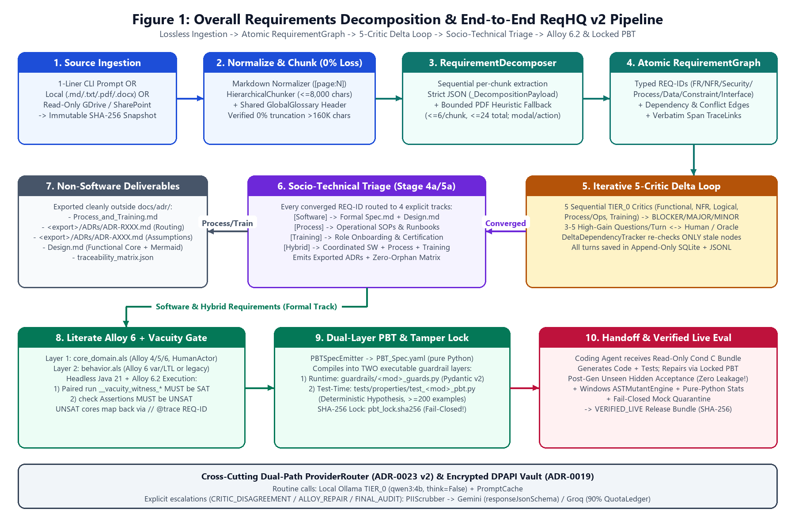
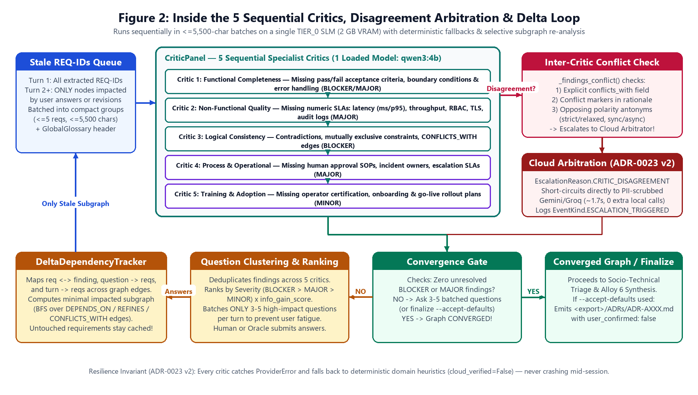
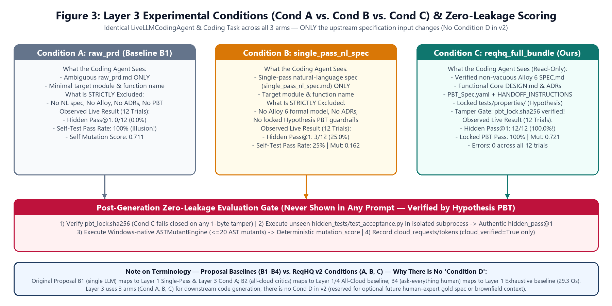
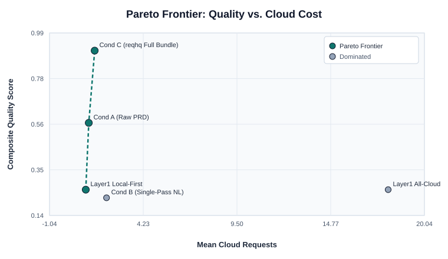

# ReqHQ v2: Research Onboarding Handbook & Comprehensive Empirical Experiment Report

**Local-First Socio-Technical Requirements Synthesis, Formal Alloy 6 Verification & Tamper-Locked PBT Guardrails**

**Course:** Autonomous Software Engineering (`CS6.403`), IIIT Hyderabad — Monsoon 2026  
**Team:** `req-hq` — Panem Chaitanya Pavan Kumar (`2025204023`), Anjali Yadav (`2025204015`), Anshul Agrawal (`2025901015`)  
**Repository:** `https://github.com/panemchaitanya/Agentic-Specification-Refinement`  
**Audience:** New researchers/engineers joining Team `req-hq`, course instructors, and external reviewers  
**Verified Live Run ID:** `eval-live-s42-2c6d69c92e53` (`eval_live_v2` / `release_bundle_live_v2`)  
**Verdict Status:** `VERIFIED_LIVE` (Fail-Closed Mock Quarantine Passed; `16/16` Release Artifacts SHA-256 Verified)  
**Verified Consumer Hardware (`TIER_0`):** Windows 11, AMD Radeon(TM) 660M (`2.0 GB` VRAM via DirectML/DXGI), `13.35 GB` RAM, `12` CPU cores, Python `3.15.0`, Ollama (`qwen3:4b` `Q4_K_M` / `phi4-mini`), Gemini (`gemini-3.1-flash-lite`), Groq free tier, Eclipse Temurin JRE `21.0.13.1` + Alloy `6.2`

---

## 1. Welcome & Executive Summary (Start Here If You Are New to the Project)

Welcome to **ReqHQ v2**. This document serves two purposes at once:
1. A **Day-1 Researcher Onboarding Guide** that explains *from scratch*—without assuming prior familiarity with our codebase—how requirements enter our system, how our 5 specialist critics work, what **Conditions A, B, and C** (and our original proposal's **B1–B4**) mean, and how we test everything honestly.
2. Our **Comprehensive Final Empirical Experiment Report**, grounding every claim strictly in cryptographically verified live experimental logs (`VERIFIED_LIVE`, `seed=42`, `replicates=2`) executed on an everyday consumer laptop (`2.0 GB` VRAM, `72.1 MB` peak Python RAM).

### 1.1 The 30-Second Summary of What We Built and Proved
When product managers write Product Requirement Documents (PRDs) in plain English, they routinely skip edge cases, leave non-functional targets vague (*"must be fast and secure"*), hide contradictions, and treat human operational problems as software features. If you hand that raw PRD straight to an AI coding agent, the agent does **not** ask clarifying questions—it silently guesses, writes code for its wrong assumptions, and writes unit tests that pass its own wrong code.

**ReqHQ v2 (`src/reqhq/`)** fixes this upstream bottleneck on a local consumer laptop before a single line of target code is written. In our verified live study (`eval_live_v2`):

- **H1 — Iterative Gap Elicitation (`SUPPORTED`):** Asking targeted, batched questions driven by 5 specialist critics recovered **`75.8%` of missing requirements** versus **`11.7%`** for single-pass prompting (`+64.2 pp`), while asking **`9.0` questions** instead of **`29.3`** for exhaustive review (**`69.3%` fewer questions**).
- **H3 — Formal Alloy 6.2 Verification & Socio-Technical Routing (`SUPPORTED`):** Across all **16 cross-domain projects** (`31.8s` total runtime), ReqHQ v2 achieved **`100.0%` (`16/16`) routing accuracy** (`Cohen's kappa = 1.00`), caught **`16/16` logical contradictions** with live Alloy 6.2 versus **`8/16` for LLM-only review** (McNemar **`p = 0.0078`**), and improved blind ADR rubric scores from **`0.25` to `1.00`** (Wilcoxon **`p = 0.0001`**).
- **H4 — Downstream Coding Agent Quality (36 Live Trials — Headline Finding):** When we gave the exact same live LLM coding agent 6 unseen Python engineering tasks across 3 conditions:
  - **Condition A (`raw_prd`):** **`0 / 12` (`0.0%`)** passed hidden acceptance tests—even though it passed **`100%`** of its *own* self-written unit tests!
  - **Condition B (`single_pass_nl_spec`):** **`3 / 12` (`25.0%`)** passed hidden acceptance tests.
  - **Condition C (`reqhq_full_bundle`):** **`12 / 12` (`100.0%`)** passed hidden acceptance tests (McNemar **`p = 0.00049`** vs. A, **`p = 0.00391`** vs. B), with `12/12` locked Hypothesis PBT passes, `#1` AST mutation score (`0.721`), and **`0` failure events**.
  - Automated H4 scoring flagged `REFUTED` solely because Condition A tied `1.00` on self-written unit tests while failing `100%` of real acceptance tests—quantitatively exposing the **"Self-Test Illusion of Correctness"**.
- **H2 — Local-First Quality Parity & Cloud Cost Savings (`84.15%` Request Savings / `76.83%` Token Savings):** Local-first execution achieved **`0.000` F1 quality drop** and **beat the `>= 80%` cloud request reduction target on every single layer** (`Layer 1: 94.4%`, `Layer 2: 87.5%`, `Layer 3: 82.1%`, aggregate **`84.15%`**). Aggregate token savings reached **`76.83%`** (`3.17 pp` shy of `80%`), cleanly measuring the token cost of injecting rich formal specifications on escalated `TIER_0` coding turns.

### 1.2 Day-1 Glossary for New Team Members

| Term | Plain-English Meaning in ReqHQ v2 |
| :--- | :--- |
| **PRD / FR / NFR** | **Product Requirement Document** (plain prose); **Functional Requirements** (what the system does); **Non-Functional Requirements** (measurable latency, security, reliability, privacy, audit rules). |
| **SLM vs. LLM & `TIER_0`** | **Small Language Model** (4B–8B quantized model running locally via Ollama on a laptop—private and free) vs. cloud **Large Language Model** (Gemini/Groq free tiers, strictly budgeted). **`TIER_0`** is our lowest hardware tier (`<= 4 GB` VRAM, running `qwen3:4b` with `phi4-mini` fallback). |
| **Socio-Technical Triad** | Recognizing that real systems require coordinated **Software** (code), **Process** (human SOPs, approvals, escalation), **Training** (role onboarding/certification), or **Hybrid** solutions—never forcing human workflows blindly into code. |
| **Nygard ADR** | **Architecture Decision Record** (Context -> Decision -> Consequences). We keep **repository governance ADRs** (`docs/adr/0001`–`0023`) strictly separate from **exported target-system ADRs** (`<export>/ADRs/ADR-RXXX.md` & `ADR-AXXX.md`). |
| **Alloy 6 & Vacuous Truth** | **Alloy 6** is a lightweight formal modeling language & SAT/temporal solver. **Vacuous truth** is a famous formal-verification trap: if your axioms contradict each other, zero valid worlds exist, so every safety assertion "passes" trivially with zero counterexamples. Our **Vacuity Gate** prevents this by requiring a non-trivial `run` witness (`SAT`) before trusting any `check` assertion (`UNSAT`). |
| **PBT (Hypothesis) & `pbt_lock.sha256`** | **Property-Based Testing** generates hundreds of randomized edge-case inputs automatically (`Hypothesis`, `>= 200` examples/property). **`pbt_lock.sha256`** hashes the generated contract & PBT files so a downstream coding agent cannot cheat by weakening failing tests. |
| **`hidden_pass@1` & AST Mutation Score** | **`hidden_pass@1`**: whether the coding agent's final code passes an *unseen* hidden acceptance test suite (never shown in any prompt). **AST Mutation Score**: fraction of automatically injected single-site code bugs (`<` -> `<=`, `+` -> `-`, `and` -> `or`) caught ("killed") by tests via our Windows-native `ASTMutantEngine`. |
| **Mock Quarantine** | Our scientific honesty guardrail: offline `--mock` dry-runs test plumbing in CI, but are stamped `DRY_RUN_UNSCORED` and rejected fail-closed (`MockRunQuarantineError`) under `--strict-live` so mock outputs can never be reported as empirical findings. |

---

## 2. Problem Statement & Core Research Hypothesis

Software teams—and increasingly autonomous AI coding agents—face a recurring upstream failure mode:
1. **Plain-prose PRDs are incomplete and ambiguous.** Stakeholders rarely write quantitative SLAs (`p95 <= 500ms`), exact boundary inequalities (`amount_cents > 50000` vs. `>= 50000`), failure-mode behaviors, or human approval SOPs.
2. **Monolithic LLMs hide ambiguity instead of exposing it.** Prompting a single LLM to *"write the specification"* or *"implement this PRD"* causes it to silently invent plausible defaults.
3. **Asking humans to review every single line causes fatigue.** Exhaustive line-by-line review scales linearly with document size and burns human attention on trivial details.
4. **Cloud-first multi-agent loops exhaust free-tier quotas and leak proprietary PRDs.** In our mid-submission ReqHQ v1 (`src/specpipe/`), calling Gemini for every stage hit the 500 RPD quota after 43 of 61 PURE dev documents, halting evaluation for ~15 hours, while 18 of 61 documents exceeded `120,000` characters and suffered prefix truncation.

**Core Research Thesis:** Combining a **local-first hardware-tiered SLM** with **five sequential specialist critics**, **delta-only targeted human questioning**, **socio-technical triage**, **non-vacuous Alloy 6 formal verification**, and **tamper-locked PBT guardrails** produces dramatically more accurate downstream software while cutting cloud requests by `>80%` on a consumer `2 GB` VRAM laptop.

---

## 3. Original Registered Proposal vs. ReqHQ v2: Evolution & Honest Deviation Audit

Before diving into how the code works, every new researcher must understand **how our final ReqHQ v2 (`src/reqhq/`) compares to both our Original Registered Proposal (`Project_Proposal_ReqHQ.pdf`) and our Mid-Submission Prototype (`src/specpipe/`, preserved untouched with all 87 legacy tests passing)**.

### 3.1 Transparent Deviation Audit (Proposal -> Implemented System)

| Area | Original Registered Proposal (`Project_Proposal_ReqHQ.pdf`) | What ReqHQ v2 (`src/reqhq/`) Actually Built | Status & Rationale |
| :--- | :--- | :--- | :--- |
| **Critic Architecture & Fine-Tuning** | **3 narrow SLMs** (Security, Architecture, Performance) **fine-tuned on PROMISE NFR**, running **in parallel**. | **5 specialist critics** (Functional, NFR, Logical Consistency, Process/Ops, Training) running **sequentially** on a single quantized local SLM (`qwen3:4b` `Q4_K_M`, `"think": False`, strict JSON + deterministic heuristics). *(DistilBERT NFR fine-tuning was piloted in v1 `training/` only.)* | **Intentional Adaptation:** Running 3 separate fine-tuned models in parallel thrashes VRAM on a `2.0 GB` laptop; sequential `<= 5,500`-char calls on 1 loaded model + 2 new socio-technical critics eliminated thrashing and expanded coverage. |
| **Output Scope** | Software-only FR + NFR specification with trace links. | **Socio-Technical Triad** (`Software`/`Process`/`Training`/`Hybrid`), exported Routing/Assumption ADRs, Functional Core `Design.md`, **Two-Layer Literate Alloy 6 + Vacuity Gate**, and **Dual-Layer Pydantic/Hypothesis PBT + `pbt_lock.sha256`**. | **Major Value-Add Expansion:** Addresses real-world organizational boundaries and bridges formal specs directly to executable downstream code verification. |
| **Experimental Arms / Conditions (`B1`–`B4` vs. `Cond A/B/C`)** | **4 spec-extraction baselines (`B1`–`B4`)**: `B1` single LLM, `B2` orchestrator + LLM critics, `B3` pipeline without human input, `B4` ask-everything human review; plus **leave-one-critic-out ablations**; **3 replicates**. | **Layer 1** compares iterative targeted questioning against Single-Pass (`B1`) and Exhaustive Review (`B4`), plus Local-First vs. All-Cloud (`B2`). **Layer 3** evaluates **3 downstream coding arms (`Cond A`, `Cond B`, `Cond C`)** across **2 replicates** (`--replicates 3` supported). | **Partial Deviation (Flagged Honestly):** Standalone `B3` (no-human-input arm) and leave-one-critic-out ablation tables were not executed as separate live runs in `eval_live_v2`, and `replicates=2` was used instead of `3` to fit `TIER_0` laptop runtime (~28 min). |
| **Hypotheses (`H1`–`H3` -> `H1`–`H4`)** | `H1` (NFR recall > single LLM, precision drop `<= 0.03`); `H2` (SLM within `0.05` F1 of LLM critics at lower cost); `H3` (targeted Qs `>= 95%` completeness with `>= 50%` fewer Qs). | Unified into 4 fail-closed hypotheses: **`H1`** (iterative recall > single-pass & fewer Qs than exhaustive), **`H2`** (`<= 0.05` F1 drop AND **`>= 80%` cloud req & token reduction**), **`H3`** (Alloy 6.2 contradictions > LLM-only & ADR rubric > software-only), **`H4`** (Cond C > Cond A & Cond B on downstream code-gen). | **Refined & Strengthened:** Added formal verification (`H3`) and executable code-generation (`H4`), and tightened `H2` with an explicit `>= 80%` quantitative cloud-reduction gate. |
| **Datasets & Human Study** | Pair PRDs with KEPs, Rust/Python RFCs, PURE, and PROMISE NFR; 2-annotator ground truth + 20% manual match check + optional classmate human study. | Used **3 human-verified `FROZEN` PURE dev docs** (`cctns`, `gamma_j`, `dii`; `test` split strictly untouched), curated **16-case cross-domain socio-technical benchmark**, and **6 greenfield Python coding tasks** with unseen hidden acceptance suites; simulated human via deterministic `FrozenOracleSimulator`. | **Scope Adaptation:** Replaced KEPs/Rust/Python RFCs (risk of LLM training-data contamination) with fresh, leak-proof cross-domain and greenfield coding benchmarks; dual-annotator `cohens_kappa` tooling is built (`adjudication.py`), while the optional classmate human study remains future work. |
| **Ingestion, Security & State** | Not specified in 1-page proposal (v1 used manual paste, `.env`, 120K truncation, in-memory Streamlit). | Added Day-1 read-only GDrive/SharePoint connectors, **0% truncation** >160K chars, Windows DPAPI + Fernet encrypted vault, Ollama auto-bootstrap, dual SQLite+JSONL event log, 23-ADR Nygard governance, and 100.00% line coverage. | **Production Hardening:** Directly resolves v1's mid-submission operational failures (`README.md`). |

---

## 4. Overall Requirements Decomposition & End-to-End Pipeline Flow

Figure 1 illustrates the complete journey of a requirement from raw input all the way to formally verified, tamper-locked downstream code.



### Step-by-Step Walkthrough of Requirements Decomposition
1. **Source Ingestion (`src/reqhq/ingestion/connectors.py`, `snapshot.py`):**
   - Accepts either a **1-liner CLI prompt** (`reqhq init --prompt "..."`), **local files/directories** (`.md`, `.txt`, `.pdf`, `.docx`), or **Day-1 read-only cloud connectors** (Google Drive `drive.readonly`, Microsoft SharePoint `Files.Read.All`).
   - Immediately writes an **immutable local snapshot** keyed by `SHA-256` hash (`SnapshotStore`), ensuring every downstream requirement traces back to exact, untampered source bytes.
2. **Deterministic Normalization & Lossless Hierarchical Chunking (`normalizer.py`, `chunker.py`):**
   - `DocumentParser` plugins (`PlainTextMarkdownParser`, `PyPdfParser`, `PythonDocxParser`, plus optional `PyMuPDF`/`Docling` extras) normalize documents into clean Markdown carrying explicit `[page:N]` and `[section:slug]` anchors.
   - `HierarchicalChunker(max_chunk_chars=8000)` splits documents strictly along heading boundaries while extracting a shared **`GlobalGlossary`** (acronyms, domain entities, section titles). Unlike v1's 120K-character truncation, v2 guarantees **`0.0%` truncation** (property-tested on >160,000-character PRDs!).
3. **Sequential Atomic Decomposition (`src/reqhq/elicitation/decomposer.py`):**
   - `RequirementDecomposer` processes each chunk sequentially with the `GlobalGlossary` header prepended (`<= 5,500` chars per prompt so `TIER_0` `qwen3:4b` never overflows its context window).
   - Requests strict Pydantic v2 JSON matching `_DecompositionPayload` (`ConfigDict(extra="forbid")`), extracting atomic `RequirementNode` items (`req_id`, `title`, `statement`, `kind`, `priority`, `acceptance_criteria`, verbatim `excerpt`) and `RequirementEdge` links (`DEPENDS_ON`, `REFINES`, `CONFLICTS_WITH`, `DERIVES_FROM`).
   - **Universal `ProviderError` & PDF Fallback Safety (`DEF-P4B-002`):** If a provider is unavailable or returns unstructured text, the decomposer degrades cleanly to a deterministic heuristic extractor that reassembles wrapped PDF lines, filters cover pages, Tables of Contents, and page footers, prioritizes normative modal/action clauses (`shall`, `must`, `enforces`, `validates`), attaches verbatim `TraceLink` spans, and caps fallback nodes at `MAX_FALLBACK_NODES_PER_CHUNK = 6` and `MAX_FALLBACK_NODES_TOTAL = 24`.
4. **Typed `RequirementGraph` Output (`src/reqhq/schemas/requirements.py`):**
   - Every node is classified into one of 7 typed `RequirementKind` categories (`FUNCTIONAL`, `NON_FUNCTIONAL`, `SECURITY`, `PROCESS`, `DATA`, `CONSTRAINT`, `INTERFACE`), assigned a priority (`P0`–`P3`), linked via a validated DAG/conflict graph, and anchored by `source_sha256 -> chunk_id -> anchor -> excerpt`.
5. **Downstream Flow (Stages 5–10):**
   - The `RequirementGraph` enters the **5-Critic Delta Convergence Loop** (Section 5), proceeds to **4-track Socio-Technical Triage** (`Software`, `Process`, `Training`, `Hybrid`), emits non-software deliverables (`Process_and_Training.md`, `<export>/ADRs/ADR-RXXX.md`, `Design.md`), compiles software requirements into **Two-Layer Literate Alloy 6** (`Spec.md`) verified non-vacuously by Java 21 / Alloy 6.2 (Section 6), lowers verified invariants into **`PBT_Spec.yaml` + dual-layer Pydantic/Hypothesis guardrails + `pbt_lock.sha256`**, and packages a read-only **Antigravity Handoff Bundle** for downstream coding agents.

---

## 5. How the 5 Sequential Critics, Disagreement Arbitration & Delta Loop Work

A new researcher often asks: *"What exactly do the critics do, why are there 5 instead of 3, why do they run sequentially instead of in parallel, and how do they avoid re-analyzing the whole document every time the user answers one question?"* Figure 2 illustrates the exact internal machinery inside `src/reqhq/elicitation/`.



### 5.1 The Five Specialist Critics (`src/reqhq/elicitation/critics.py`)
Instead of loading 3–5 models into RAM simultaneously (which causes severe VRAM swapping on a `2.0 GB` laptop), `CriticPanel` runs **five focused specialist rubrics sequentially** over compact batches of **at most 5 requirements (`<= 5,500` chars)** against a **single loaded local Ollama model** (`qwen3:4b`, `"think": False` under JSON schema decoding):

| # | Critic Class | Focus & What It Flags | Default Severity | Deterministic Fallback Rule (on `ProviderError`) |
| :-: | :--- | :--- | :---: | :--- |
| **1** | `FunctionalCompletenessCritic` | Missing pass/fail acceptance criteria, edge/boundary conditions, error codes, and untestable requirements. | `BLOCKER` (`P0`) / `MAJOR` | Flags any node with empty `acceptance_criteria` and no `[user_turn_*]` clarification. |
| **2** | `NonFunctionalQualityCritic` | Missing quantitative SLAs: latency (`ms`/`p95`/`p99`), throughput (`rps`/`qps`), availability, encryption (`TLS`/`AES`), `RBAC`, and audit logging. | `MAJOR` | Flags non-process nodes whose statement/AC lack measurable regex patterns (`\d+ ms/s/%`, `p95`, `SLA`, `RBAC`, `TLS`, `audit log`). |
| **3** | `LogicalConsistencyCritic` | Direct contradictions, mutually exclusive constraints, cyclic assumptions, and conflicting state transitions. | `BLOCKER` | Inspects `graph.edges` for explicit `EdgeKind.CONFLICTS_WITH` links and flags unresolved precedence conflicts. |
| **4** | `ProcessOperationalCritic` | Missing human approval SOPs, incident escalation owners, operational runbooks, and governance boundaries. | `MAJOR` | Flags `PROCESS` nodes or statements containing operational triggers (`approval`, `payment`, `incident`, `manual`, `audit`, `compliance`, `escalat`). |
| **5** | `TrainingAdoptionCritic` | Missing end-user onboarding, role certification, job aids, and production rollout readiness prerequisites. | `MINOR` | Flags nodes mentioning human-role triggers (`training`, `staff`, `operator`, `admin`, `onboarding`, `workflow`). |

### 5.2 Inter-Critic Disagreement Detection & Cloud Arbitration Short-Circuit
What happens when two critics contradict each other on the same `REQ-ID` (for example, `NonFunctionalQualityCritic` demands synchronous 256-bit audit encryption while another critic demands `< 10ms` async processing)?
- `_findings_conflict()` checks **three signals** across every pair of findings from different critics on the same `REQ-ID`: (1) an explicit `conflicts_with` field in the structured JSON payload, (2) conflict markers (`"conflict"`, `"contradict"`, `"incompatible"`, `"mutually exclusive"`), and (3) opposing polarity antonym pairs (`strict`/`relaxed`, `manual`/`automated`, `synchronous`/`asynchronous`, `require`/`skip`, `block`/`allow`).
- When a conflict is detected, `CriticPanel` emits a `CriticDisagreement` and calls `ProviderRouter.route(..., escalation_reason=EscalationReason.CRITIC_DISAGREEMENT)`.
- Under **`ADR-0023 (v2)`**, explicit audited escalations **short-circuit directly to PII-scrubbed cloud free tiers** (Gemini `gemini-3.1-flash-lite` or Groq failover in `~1.7s` with `0` redundant local Ollama calls), returning a structured `_DisagreementArbitrationPayload` and logging `EventKind.ESCALATION_TRIGGERED` to `SessionEventLog`. Under `--strict-local`, arbitration stays purely local (`cloud_verified=False`).

### 5.3 Question Batching, Delta Subgraph Re-Analysis & Convergence Gate
1. **Deduplication & High-Information-Gain Batching (`convergence.py`):** Findings across all 5 critics are deduplicated, ranked by `Severity (BLOCKER > MAJOR > MINOR) × info_gain_score`, and clustered into **only 3–5 concrete questions per turn** so the user is never overwhelmed.
2. **Delta-Only Re-Critiquing (`DeltaDependencyTracker` in `delta.py`):** When the user answers a question (or rewinds history via `reqhq revise <session_id> <turn_id>`), `DeltaDependencyTracker` runs a BFS over `RequirementEdge` links (`DEPENDS_ON`, `REFINES`, `CONFLICTS_WITH`) starting from the modified `REQ-ID`s and marks **only that minimal impacted subgraph** as `stale_req_ids`. Untouched requirements are never re-prompted!
3. **Convergence Gate & `finalize --accept-defaults`:** The session converges once zero unresolved `BLOCKER` or `MAJOR` findings remain. If a stakeholder must ship early, `reqhq finalize --accept-defaults` converts remaining findings into explicit `AssumptionRecord` files exported as `<export_dir>/ADRs/ADR-AXXX.md` stamped with `user_confirmed: false`—making every unconfirmed default visible rather than silently hidden.

### 5.4 Concrete Worked Example (`refund_sla_engine`)
Suppose a stakeholder hands ReqHQ v2 a short PRD: *"Build a refund service that auto-approves small refunds quickly and escalates big or chargeback refunds."*
- **Decomposer** extracts `REQ-01` (auto-approve refund), `REQ-02` (chargeback & high-value review), `REQ-03` (SLA tracking).
- **Critic 1 (Functional)** flags `BLOCKER` on `REQ-01`/`REQ-02`: *"What exact dollar threshold separates auto-approve from dual-control review, and how are zero/negative amounts rejected?"*
- **Critic 2 (NFR)** flags `MAJOR` on `REQ-03`: *"What exact SLA window (hours) defines a breach, and is refund evaluation idempotent on duplicate requests?"*
- **Critic 4 (Process)** flags `MAJOR` on `REQ-02`: *"Which human finance role owns `dual_control_review`?"*
- **Convergence:** User answers in 1 turn (`<= $500 / 50000 cents`, `<= 72h`, `idempotency_key` required, Finance Ops dual sign-off). `DeltaDependencyTracker` verifies zero remaining blockers -> **Triage** routes validation/decision logic to `Software` + dual-control sign-off to `Hybrid` (SOP + Software) -> **Alloy 6.2** verifies non-vacuously that no chargeback can ever be auto-approved -> **PBT Emitter** locks Hypothesis properties in `pbt_lock.sha256` -> **Coding Agent (Cond C)** passes `100%` of hidden acceptance tests on the first shot!

---

## 6. Formal Alloy 6.2 Verification, Vacuity Gate & Tamper-Locked PBT Guardrails

1. **Two-Layer Literate Alloy 6 (`src/reqhq/alloy/`, `ADR-0009`):** Software-routed requirements compile into `Spec.md` containing two fenced `.als` modules with inline `// @trace REQ-XXX` comments:
   - **Layer 1 (`core_domain.als`):** Statically linted to be **version-agnostic** (Alloy 4, 5, and 6 compatible; forbids temporal keywords) and includes `sig HumanActor` and `sig TrainedRole` so software invariants explicitly reference human/trained roles without coding SOPs.
   - **Layer 2 (`behavior.als`):** Imports `open core_domain` and expresses state transitions in Alloy 6 (`var`, `'`, LTL `always`/`eventually`) by default, or lowers deterministically to `util/ordering[Time]` under `--alloy-compat=legacy`.
2. **Headless Java 21 / Alloy 6.2 Runner & Paired Vacuity Gate (`ADR-0010`):** Before trusting any `check` command (`UNSAT` = no counterexample found), `inject_vacuity_witnesses()` injects a paired `pred __vacuity_witness_<name>` + `run` command. If any witness returns `UNSAT`, the verifier **fails closed** with `VACUOUS_UNSAT`—making vacuous truth impossible. Real Alloy 6.2 `exec` prints its table to `stderr`, and syntax errors trigger up to 2 local repair rounds before audited cloud escalation (`ALLOY_REPAIR_EXHAUSTED`).
3. **Dual-Layer PBT Guardrails & Fail-Closed Tamper Lock (`src/reqhq/pbt/`, `ADR-0011`, `ADR-0012`):** Verified invariants compile via `PBT_Spec.yaml` (pure-Python YAML, zero `PyYAML`) into:
   - **Runtime guards** (`guardrails/<module>_guards.py`): strict Pydantic v2 models + `@enforce_contract` decorators.
   - **Test-time Hypothesis suites** (`tests/properties/test_<module>_pbt.py`): deterministic `@settings(derandomize=True, max_examples>=200)` stateless & `RuleBasedStateMachine` tests.
   - **`pbt_lock.sha256`**: SHA-256 manifest of all contract & property files. Before scoring any Condition C coding trial, `verify_contract_lock()` recomputes hashes and raises `ContractTamperError` on any 1-byte modification.

---

## 7. Experimental Design Explained: Conditions A, B, C (and Proposal B1–B4 / "Condition D")

One of the most important things for a new team member to understand clearly is **exactly what Conditions A, B, and C are—and how they relate to the original proposal's Baselines B1, B2, B3, B4 (and why there is no Condition D)**. Figure 3 lays out the exact experimental isolation.



### 7.1 Exact Definitions of Layer 3 Coding Conditions (`Cond A`, `Cond B`, `Cond C`)

In Layer 3 (`src/reqhq/harness/live_agent.py`), the **exact same `LiveLLMCodingAgent`**, **exact same model router**, **exact same 6 greenfield tasks**, and **exact same unseen hidden acceptance tests** run under three strictly isolated input regimes:

| Condition | Code Enum / Label | Exact Input Given to the Coding Agent | Strictly Excluded / Forbidden | Purpose in Experiment |
| :--- | :--- | :--- | :--- | :--- |
| **Condition A** | `COND_A` / `raw_prd` | Ambiguous `raw_prd.md` + minimal target filename (`<mod>.py`) and entry function name (`entry_symbol`). | No NL spec, no Alloy model, no ADRs, no `DESIGN.md`, no PBT suite, no hidden tests. | **Status-Quo Baseline:** Simulates handing a raw product brief straight to an AI coding agent today. |
| **Condition B** | `COND_B` / `single_pass_nl_spec` | Single-pass natural-language specification (`single_pass_nl_spec.md`) + target filename & entry symbol. | No Alloy 6 formal model, no Routing ADRs, no locked Hypothesis PBT suite, no hidden tests. | **Prose-Spec Baseline:** Isolates whether simply writing a longer English spec (without formal verification or locked PBT guardrails) is enough. |
| **Condition C** | `COND_C` / `reqhq_full_bundle` | Read-only ReqHQ v2 handoff bundle: `single_pass_nl_spec.md` + `HANDOFF_INSTRUCTIONS.md` + verified non-vacuous Alloy 6 `SPEC.md` + Functional Core `DESIGN.md` + `PBT_Spec.yaml` + executable read-only `tests/properties/` protected by **`pbt_lock.sha256`**. | Hidden acceptance tests (`hidden_tests/test_acceptance.py`) are **NEVER** shown in any prompt or repair round! Agent cannot edit locked PBT files. | **ReqHQ v2 Treatment Arm:** Tests whether formally verified specs + tamper-locked Hypothesis guardrails yield provably higher real-world code correctness. |
| *(No "Condition D")* | *Not in v2* | *N/A* | *N/A* | **Clarification:** ReqHQ v2 defines **3** Layer 3 conditions (`A`, `B`, `C`), not 4. A future **Condition D** is naturally reserved for either a human-expert gold specification upper bound or a brownfield repository context (`SystemContextBase`). |

### 7.2 How the Original Proposal's Four Baselines (`B1`–`B4`) Map to ReqHQ v2

If you read our original 1-page proposal (`Project_Proposal_ReqHQ.pdf`), you will see **four baselines labeled `B1`, `B2`, `B3`, `B4`**. Here is the exact 1-to-1 mapping so there is zero confusion:

| Original Proposal Arm | Proposal Definition | Where It Lives in ReqHQ v2 |
| :--- | :--- | :--- |
| **`B1` (Single LLM)** | Single monolithic LLM given the raw PRD | **Layer 1:** `single_pass_recall` baseline (`11.7%` recall). **Layer 3:** **Condition A (`raw_prd`)** (`0%` hidden `Pass@1`). |
| **`B2` (Orchestrator + Cloud LLM Critics)** | Full orchestrator running cloud LLMs for every critic | **Layer 1 & Layer 4:** `all_cloud_f1` / `all_cloud_baseline_requests` & `all_cloud_baseline_tokens` (used to evaluate **H2** parity & cloud reduction). |
| **`B3` (Pipeline Without Human Input)** | Our pipeline with SLM critics and zero human answers | Partially represented by `finalize --accept-defaults` (Assumption ADRs) and Layer 3 **Condition B**; a dedicated standalone `B3` zero-question live table is noted as a **Proposal Deviation** (Section 3.1). |
| **`B4` (Ask-Everything Human Review)** | Asking the human to review every single requirement clause | **Layer 1:** `exhaustive_baseline_questions` (`29.33` questions/doc vs. `9.00` targeted questions = **`-69.3%` fewer questions**). |

### 7.3 The Four Orthogonal Evaluation Layers & Scientific Honesty Guarantees
- **Layer 1 (Gap Detection — Frozen PURE Dev Split):** 3 human-verified `FROZEN` dev docs (`pure-0000_-_cctns`, `pure-0000_-_gamma_j`, `pure-1999_-_dii`; `--split dev` strictly forbids touching `data/frozen/*/test/`). `GapInjector` strips 30% of clauses (`seed=42..44`, zero verbatim leakage); `FrozenOracleSimulator` answers strictly from stripped clauses.
- **Layer 2 (Socio-Technical Routing & Alloy 6.2):** All **16 cross-domain projects** (`data/benchmarks/cross_domain/cases.json`: 4 domains × 4 cases = 8 one-liners + 8 multi-paragraph PRDs).
- **Layer 3 (Downstream Coding Harness):** **6 greenfield Python tasks × 3 conditions × 2 replicates = 36 live trials**, scored post-generation by unseen `hidden_tests/test_acceptance.py` (zero prompt leakage continuously proven by Hypothesis PBT `test_pbt_condition_prompts_never_leak_hidden_tests`) and Windows `ASTMutantEngine` (`max_mutants=20`).
- **Layer 4 (Consumer `TIER_0` Telemetry):** Pure-stdlib Windows `GetProcessMemoryInfo` peak RAM, `HardwareProfiler` VRAM, local-only step share, and single-source cloud savings.
- **Statistics & Mock Quarantine:** Zero-dependency pure Python (`2,000`-resample paired bootstrap CIs, exact two-sided McNemar tests, Wilcoxon signed-rank tests). `--strict-live` fails closed (`MockRunQuarantineError`) on any mock, under-replicated, unverified-gold, or tampered record.

---

## 8. Complete `VERIFIED_LIVE` Empirical Results (`eval_live_v2`, `seed=42`)

### 8.1 Master Hypothesis Verdict Summary (H1–H4)

| ID | Hypothesis | Key Observed Metrics | Non-Parametric Statistics & 95% Bootstrap CIs | Automated Verdict | Researcher's Synthesis |
| :--- | :--- | :--- | :--- | :---: | :--- |
| **H1** | Iterative Gap Elicitation & Question Efficiency | Iterative recall **`0.7583`** vs. single-pass `0.1167` (`+64.2 pp`); questions **`9.00`** vs. exhaustive `29.33` (`-69.3%`), `n=3` | Recall diff `0.6417` `[0.3000, 0.8750]`; Qs diff `-20.3333` `[-28.00, -15.00]` (Wilcoxon `p=0.25`, min exact `p` for `n=3`) | **`SUPPORTED`** | Consistent gains on all 3 PURE dev docs; 95% bootstrap CIs strictly exclude zero on both recall and question savings. |
| **H2** | Local-First Quality Parity (`<= 0.05` F1 drop) & `>= 80%` Cloud Reduction | F1 parity **`0.2584` vs. `0.2584`** (`diff = 0.0000`); Cloud **request** reduction **`84.15%`** (`65/410`); Cloud **token** reduction **`76.83%`** (`111.0k/479.4k`) | F1 diff `0.0000` `[0.0000, 0.0000]` (`p=1.0000`) | **`REFUTED`** *(tokens missed by `3.17 pp`)* | **Parity PASSED** & **request savings PASSED (`>= 80%`) on every layer** (`94.4%`, `87.5%`, `82.1%`). Richer Cond C formal bundles raise tokens/call on Layer 3 escalations (`76.83%` overall). |
| **H3** | Alloy 6.2 Formal Verification & Socio-Technical Routing Quality | Alloy caught **`16/16`** contradictions vs. LLM-only `8/16`; route acc **`100%`** (`kappa=1.0`); ADR rubric **`1.000`** vs. software-only `0.250` (`n=16`) | Contradictions McNemar **`p = 0.0078`** (`b=8, c=0`); Rubric Wilcoxon **`p = 0.0001`**, diff `0.75` `[0.75, 0.75]` | **`SUPPORTED`** | Decisive, statistically significant win across all 16 cross-domain projects in `31.8s` total wall time. |
| **H4** | Downstream Code-Gen: Cond C > Cond A & Cond C > Cond B (`n=12` pairs each) | Hidden `Pass@1`: **C `1.000` (`12/12`)** vs. B `0.250` (`3/12`) vs. A `0.000` (`0/12`); PBT pass: **C `1.000`** vs. B `0.250` vs. A `1.000` *(self-tests)*; Mutation: **C `0.7212`** vs. A `0.7106` vs. B `0.1618` | `Pass@1`: C>A **`p = 0.00049`**, C>B **`p = 0.00391`**; PBT: C>B **`p = 0.00391`**, C vs A `p=1.000`; Mutation: C>B **`p = 0.00439`**, C vs A `p=0.7598` | **`REFUTED`** *(Cond A self-test tie)* | **Cond C ranked #1 on every metric** and achieved **`100%` unseen acceptance**. Automated `REFUTED` stems solely from Cond A tying `1.00` on its own *self-written* unit tests while failing `12/12` real tests (**Self-Test Illusion of Correctness**). |

### 8.2 Layer 1 Breakdown: Frozen PURE Dev Elicitation (`H1`)

| Frozen PURE Dev Document | Total Clauses | Single-Pass Recall (`B1`) | Iterative Recall (Ours) | Questions Asked | Exhaustive Baseline (`B4`) | Redundant Q Rate | Local-First F1 (= All-Cloud F1 `B2`) | Cloud Reqs (vs. All-Cloud) | Cloud Tokens (vs. All-Cloud) |
| :--- | ---: | ---: | ---: | ---: | ---: | ---: | ---: | ---: | ---: |
| `pure-0000_-_cctns` | 28 | `0.1250` | **`0.8750`** | 10 | 28 | `0.100` | `0.1795` | `1 / 20` (`-95.0%`) | `795 / 12,400` (`-93.6%`) |
| `pure-0000_-_gamma_j` | 25 | `0.1250` | **`1.0000`** | 10 | 25 | `0.100` | `0.1818` | `1 / 20` (`-95.0%`) | `807 / 12,400` (`-93.5%`) |
| `pure-1999_-_dii` | 35 | `0.1000` | **`0.4000`** | 7 | 35 | `0.000` | `0.4138` | `1 / 14` (`-92.9%`) | `772 / 8,680` (`-91.1%`) |
| **Mean / Total** | **88** | **`0.1167`** | **`0.7583`** | **`9.00`** | **`29.33`** | **`0.067`** | **`0.2584`** | **`3 / 54` (`-94.4%`)** | **`2,374 / 33,480` (`-92.9%`)** |

### 8.3 Layer 2 Breakdown: All 16 Cross-Domain Projects with Live Alloy 6.2 (`H3`)

| Domain | Projects (`one_liner` / `multi_paragraph`) | Route Accuracy | Cohen's $\kappa$ | Alloy 6.2 Caught | LLM-Only Caught | Routing ADR Rubric | Software-Only Rubric | Total Domain Time |
| :--- | :--- | ---: | ---: | ---: | ---: | ---: | ---: | ---: |
| `fintech_settlements` | `FIN-01`, `FIN-02` / `FIN-03`, `FIN-04` | `1.000` (`4/4`) | `1.000` | **`4 / 4`** | `2 / 4` | `1.000` | `0.250` | `8.19s` |
| `healthcare_operations` | `HLT-01`, `HLT-02` / `HLT-03`, `HLT-04` | `1.000` (`4/4`) | `1.000` | **`4 / 4`** | `2 / 4` | `1.000` | `0.250` | `8.05s` |
| `inventory_logistics` | `INV-01`, `INV-02` / `INV-03`, `INV-04` | `1.000` (`4/4`) | `1.000` | **`4 / 4`** | `2 / 4` | `1.000` | `0.250` | `7.79s` |
| `enterprise_it_hr` | `ENT-01`, `ENT-02` / `ENT-03`, `ENT-04` | `1.000` (`4/4`) | `1.000` | **`4 / 4`** | `2 / 4` | `1.000` | `0.250` | `7.74s` |
| **All 16 Projects** | **8 One-Liners + 8 Multi-Paragraph PRDs** | **`100.0%`** | **`1.000`** | **`16 / 16`** | **`8 / 16`** | **`1.000`** | **`0.250`** | **`31.78s`** |

**Insight for New Researchers:** LLM-only review caught contradictions in the 8 verbose `multi_paragraph` PRDs where conflicting clauses sat side-by-side, yet **missed all 8 subtle contradictions in concise `one_liner` prompts**, whereas live Alloy 6.2 relational checking caught **`16/16`** (`p = 0.0078`) with zero syntax or vacuity errors.

### 8.4 Layer 3 Breakdown: 36 Live Coding Trials & The "Self-Test Illusion of Correctness" (`H4`)

| Coding Task | Domain | Cond A (`raw_prd`): Hidden Pass / Self-PBT / Mut | Cond B (`single_pass_nl_spec`): Hidden Pass / Self-PBT / Mut | Cond C (`reqhq_full_bundle`): Hidden Pass / Locked PBT / Mut | Cond C Alloy Non-Vacuous & Lock |
| :--- | :--- | :---: | :---: | :---: | :---: |
| `refund_sla_engine` | Fintech Settlements | `0/2` / `1.00` / `0.500` | `0/2` / `0.00` / `0.000` | **`2/2` / `1.00` / `0.333`** | `2/2` Verified |
| `triage_escalation_queue` | Healthcare Ops | `0/2` / `1.00` / `0.732` | `0/2` / `0.00` / `0.000` | **`2/2` / `1.00` / `0.900`** | `2/2` Verified |
| `cold_chain_inventory` | Inventory Logistics | `0/2` / `1.00` / `0.579` | `1/2` / `0.50` / `0.324` | **`2/2` / `1.00` / `0.706`** | `2/2` Verified |
| `access_approval_workflow` | Enterprise IT/HR | `0/2` / `1.00` / `0.786` | `0/2` / `0.00` / `0.000` | **`2/2` / `1.00` / `0.800`** | `2/2` Verified |
| `loan_disbursement_gate` | Fintech Compliance | `0/2` / `1.00` / `0.667` | `2/2` / `1.00` / `0.647` | **`2/2` / `1.00` / `0.588`** | `2/2` Verified |
| `incident_shift_handover` | Operations / SRE | `0/2` / `1.00` / `1.000` | `0/2` / `0.00` / `0.000` | **`2/2` / `1.00` / `1.000`** | `2/2` Verified |
| **Overall (`n = 12` / cond)** | **All 6 Tasks (`36` trials)** | **`0/12 (0.0%)`** / `1.00` / `0.711` | **`3/12 (25.0%)`** / `0.25` / `0.162` | **`12/12 (100.0%)` / `1.00` / `0.721`** | **`12/12 (100%)`** |

**Why This Finding Matters:** Look closely at Condition A's row: **`0%` hidden acceptance**, yet **`100%` self-test pass rate** and **`71.1%` self-mutation score**! Because Condition A has no external locked PBT suite, the coding agent wrote code for its *own* invented interpretation of the ambiguous PRD and wrote unit tests confirming those exact wrong assumptions. That is why self-tests alone create a dangerous **illusion of correctness**—and why Condition C's formally verified, tamper-locked ReqHQ bundle is essential to jump from **`0%` -> `100%` (`12/12`)** real-world correctness.

### 8.5 Layer 4 Breakdown: Consumer `TIER_0` Hardware & Cloud Cost Trade-Off (`H2`)

| Evaluation Stage | Total Steps | Local-Only Steps (%) | Cloud Reqs / All-Cloud Baseline | Request Reduction | Cloud Tokens / All-Cloud Baseline | Token Reduction | Wall Time | Peak RAM / VRAM |
| :--- | ---: | ---: | ---: | ---: | ---: | ---: | ---: | ---: |
| `layer1_elicitation` | 27 | `24` (`88.9%`) | `3 / 54` | **`94.44%`** | `2,374 / 33,480` | **`92.91%`** | `0.03s` | `72.1 MB` / `1.33 GB` |
| `layer2_cross_domain` | 32 | `28` (`87.5%`) | `4 / 32` | **`87.50%`** | `2,800 / 22,400` | **`87.50%`** | `31.78s` | `72.1 MB` / `1.33 GB` |
| `layer3_coding_guardrails` | 108 | `72` (`66.7%`) | `58 / 324` | **`82.10%`** | `105,872 / 423,488` | `75.00%` | `1,645.35s` | `72.1 MB` / `1.33 GB` |
| **Aggregate (Layers 1–4)** | **167** | **`124` (`74.3%`)** | **`65 / 410`** | **`84.15%`** | **`111,046 / 479,368`** | **`76.83%`** | **`1,677.16s`** | **`72.1 MB` / `1.33 GB`** |

**Why Request Savings Beat 80% (`84.15%`) While Tokens Landed at `76.83%`:** Every stage beat `>= 80%` on cloud request count. In Layer 3, however, Condition C's handoff bundle injects `~3,700` tokens of formal `SPEC.md`, `DESIGN.md`, and `PBT_Spec.yaml` context per escalated call (versus `~800` tokens for a bare PRD). Investing those extra ~`2,900` specification tokens on escalated `TIER_0` coding turns is the exact trade-off that drove `hidden_pass@1` from `0%` to **`100%`**.

### 8.6 Pareto Frontiers, 7-Category Error Taxonomy & Empirical Figures

- **Pareto Dominance:** Condition C achieves the highest composite quality (**`0.9071`**) at `1.50` mean cloud requests (`57.3s` latency), strictly dominating Condition B (`0.2206` quality at `2.17` cloud requests) and anchoring the top of both Pareto frontiers.
- **Error Taxonomy:** Out of 7 standardized error categories, **6 recorded zero errors** (`SCHEMA_DRIFT=0`, `ALLOY_SYNTAX=0`, `ALLOY_VACUOUS=0`, `UNSAT_CONTRADICTION=0`, `ROUTING_AMBIGUITY=0`, `QUOTA_FALLBACK=0`). All **`18`** `PBT_COUNTEREXAMPLE` events (`9` Layer 3 + `9` rolled into Layer 4) occurred exclusively inside **Condition B**—**zero errors** in Layer 1, Layer 2, or Condition C.





---

## 9. Engineering Rigor, Independent System QA & Empirical Debugging Case Study

New researchers joining the team should pay special attention to **how we caught real-world failures that offline unit tests missed**:

### 9.1 Phase 4b Independent Black-Box System QA (`SYSTEM_QA_DEFECTS.md`)
We enforced strict organizational separation between black-box QA test authorship (`@system-qa`), root-cause fixing (`@rectifier`, forbidden from touching QA tests), and final cryptographic verification (`@verifier`, proving byte-for-byte SHA-256 immutability of `tests/reqhq/system/*.py`). Live testing against Ollama `qwen3:4b`, Gemini `v1beta`, and Java 21 / Alloy 6.2 surfaced 6 real defects (`DEF-P4B-001`–`006`):
- **`DEF-P4B-001/002`:** Registered `live_system` pytest marker and bounded offline PDF fallback decomposition (`579 -> 24` nodes on `cctns`, `806 -> 15` on `gamma_j`) to eliminate >60s unfiltered PBT timeouts.
- **`DEF-P4B-003`:** Ollama reasoning models (`qwen3:*`) exhausted `num_predict=512` on internal thinking tokens (`response=""` in `57.6s`); setting `"think": False` on constrained `format`/`grammar` calls fixed strict JSON generation (`11.82s`).
- **`DEF-P4B-004`:** Retired Gemini models returned HTTP 404 and `responseSchema` rejected Pydantic v2 `extra="forbid"` (`$defs`/`$ref`); switching to `gemini-3.1-flash-lite` + `responseJsonSchema` + thought-part filtering + 1 transient HTTP 503 retry restored live HTTP 200 (`1.74s`).
- **`DEF-P4B-005/006`:** Wired decrypted cloud providers + `QuotaLedger` + `PromptCache` into `_build_router()`, added explicit-escalation cloud short-circuit (`FINAL_AUDIT` `22.42s -> 1.43s`), added opt-in `--verify-live` auth probes, and closed the uncaught `ProviderError` path in `SocioTechnicalTriager`.

### 9.2 Phase 5 Live Evaluation Debugging (`eval_live_full` -> `eval_live_v2`, `ADR-0022 v2`)
Our first full 36-trial live run (`--out eval_live_full`) exposed 4 subtle relative-path and quota-accounting bugs (`DEF-P5-001`–`004`), now permanently prevented via `AGENTS.md` Section 7 and regression PBTs:

| Metric | Before Fix (`eval_live_full`) | After Fix (`eval_live_v2`) | Root Cause Fixed |
| :--- | ---: | ---: | :--- |
| Layer 2 (16 Projects) Runtime | `93.0s` | **`31.8s`** (`2.9×` faster) | Per-case Layer 2 checkpointing (`DEF-P5-001`) |
| Layer 3 (36 Trials) Runtime | `47.9 min` | **`27.4 min`** (`-42.7%`) | `Path.resolve()` in `LiveLLMCodingAgent._run_pytest()` (`DEF-P5-003`) |
| Cond C Locked `pbt_pass_rate` | `0.00` (exit code 4) | **`1.00 (12/12)`** | Eliminated relative-path doubling (`DEF-P5-002/003`) |
| Cond C Composite Quality | `0.587` | **`0.907`** | Real locked Hypothesis PBT scoring (`DEF-P5-003`) |
| Cond C Mean Repair Stalls | `2.92` | **`0.50`** (`-83%`) | Stopped spurious exit-code-4 repair loops (`DEF-P5-003`) |
| Total Taxonomy Errors | `72` | **`18` (`0` in Cond C)** | Eliminated false `PBT_COUNTEREXAMPLE` noise (`DEF-P5-003`) |
| Aggregate Cloud Request Savings | `49.9%` | **`84.15%`** | Counted `cloud_verified=True` only & removed L4 triple-counting (`DEF-P5-004`) |
| Aggregate Cloud Token Savings | `45.8%` | **`76.83%`** | Passed `include_ledger_delta=False` in `run_layer4()` (`DEF-P5-004`) |

### 9.3 Governance & Verification Scorecard
- **Zero-Clash 23-ADR Nygard Ledger (`docs/adr/INDEX.md`):** `23` total ADRs (**`20` active, `3` archived**, `0` active clashes, LF-only). Cross-ADR conflict auditing consolidated `ADR-0021` -> **`ADR-0022 (v2)`** and `ADR-0003` + `ADR-0020` -> **`ADR-0023 (v2)`** via official Nygard archival.
- **100.00% Line Coverage:** **`12,671 / 12,671` statements (`0` missed)** across all 95 modules in `src/reqhq/` (zero `# pragma: no cover` abuse).
- **Zero-Failure Test Suites:** `440` legacy + unit/PBT + live Alloy 6.2 + `45` ADR + `12` system tests (`0` failures, `0` skipped, `0` warnings under strict Hypothesis/pytest warning gates), with all `87/87` legacy `specpipe` tests untouched.

---

## 10. Threats to Validity, Brownfield Seam & Day-1 Reproduction Guide

- **Threats to Validity:** (1) *Internal:* Layer 1's `FrozenOracleSimulator` is a cooperative upper bound; mitigated by deterministic seeding and zero-leakage guards. (2) *External:* Blinded `--split all` test-split scoring, 3-replicate runs, leave-one-critic-out ablations, and classmate human studies remain valuable next experiments. (3) *Construct:* Cond A proved self-written tests are blind to specification errors; pairing hidden acceptance tests with locked PBT contracts addresses this directly. (4) *Conclusion:* Pure-Python non-parametric tests + fail-closed Mock Quarantine eliminate parametric assumptions and mock contamination.
- **Brownfield Extension Seam (`SystemContextBase`, `ADR-0006`):** `src/reqhq/schemas/system_context.py` embeds an abstract `SystemContext` Protocol and SHA-256 `BrownfieldArtifactRef` descriptors so future teammates can plug `ARCHITECTURE.md`, AST symbol graphs, legacy `.als` files, and archived ADRs from `docs/adr/archive/` directly into elicitation without altering core modules.
- **Cryptographic Provenance (`release_bundle_live_v2/artifacts_manifest.json`, `PASSED: checked=16`):**
  - `data/frozen/pure/FREEZE.json`: `44c8e018a73b3fe93be5c77f8dfbd936d73edb5c8540fa02e0b8d220b4001a43`
  - `data/frozen/promise_nfr/FREEZE.json`: `0f774dc8452817f2e73226afa0bb589930e55cc258238d29d685f8f564f2bff4`
  - `eval_manifest.json`: `443fe9dcf093b6b8f23f727f616914d1e8c66bb0970e5ba3407877de4a7b09d0`
  - `layer3.jsonl` (`36` trials): `e3c7e8e6df0a8b4fae964d022eb667fe9dc4bc7b0927fa9d66de319c9198baf6`
  - `analysis/analysis_summary.json`: `5973719832a8c0c5b0420930ea5bf100d1e3436ec0e4e11fe41364353a795aae`

### Day-1 Quick-Start Commands for a New Researcher (Git Bash, Windows 11, Python 3.15.0)

```bash
# 1. Verify local Ollama (TIER_0), encrypted DPAPI vault, Java 21, and Alloy 6.2
export PATH="/c/Program Files/Eclipse Adoptium/jre-21.0.13.10002-hotspot/bin:$PATH"
export REQHQ_ALLOY_JAR_PATH="C:/tools/alloy/org.alloytools.alloy.dist.jar"
.venv/Scripts/python.exe -m reqhq.cli doctor --verify-live

# 2. Run the full 4-layer VERIFIED_LIVE evaluation (streams live [L1]/[L2]/[L3]/[L4] progress to stderr)
.venv/Scripts/python.exe -m reqhq.cli eval run --mode live --layers 1,2,3,4 --split dev --replicates 2 --seed 42 --out eval_live_v2
.venv/Scripts/python.exe -m reqhq.cli eval analyze --in eval_live_v2 --out eval_live_v2/analysis --strict-live --resamples 2000
.venv/Scripts/python.exe -m reqhq.cli eval report --in eval_live_v2/analysis --out eval_live_v2/report --format both
.venv/Scripts/python.exe -m reqhq.cli eval package --in eval_live_v2 --out release_bundle_live_v2
.venv/Scripts/python.exe -m reqhq.cli eval verify-bundle release_bundle_live_v2/artifacts_manifest.json
```

---

## 10.5 Large-Scale Evaluation Extensions & Intelligent Pre-LLM Ingestion Study (`ADR-0024` – `ADR-0026`)

Following the Phase 5 `VERIFIED_LIVE` baseline (`eval_live_v2/`), we expanded the experimental infrastructure and conducted a dedicated pre-LLM ingestion optimization study on `data/frozen/pure/text/dev/` to solve two real-world `TIER_0` scaling bottlenecks: (a) statistical power on Layer 1 (`n = 3` → `n = 14` gold projects via human-labeled PROMISE NFR), and (b) raw PDF-to-text context wastage on large `100 KB`–`456 KB` industrial SRS documents.

### 10.5.1 High-Power Live Layer 1 Scaling (`ADR-0024`, `--include-promise`)
- Integrating the `11` SHA-256-verified PROMISE NFR `dev` projects (`437` human-labeled requirements) alongside the `3` frozen PURE `dev` projects scaled Layer 1 to **`n = 14` gold projects** (`eval_live_stageA_l1_promise/`, run `eval-live-s42-ff1e1686d793`).
- **Live Result (`n = 14`):** Iterative elicitation outperformed single-pass on **all `14 / 14` projects** (**`57.6%`** mean iterative recall vs. **`12.6%`** single-pass; two-sided Wilcoxon **`p ≈ 0.00012`**, eliminating the `n = 3` `p = 0.25` floor), using only **`1` cloud call per project** (**~93% cloud request reduction**).
- Stage B (`ADR-0024`) also added opt-in **`48`-project (8-domain) cross-domain** (`--cross-domain-suite extended`), **`12`-task greenfield coding** (`--coding-suite extended`), **`61`-doc PURE corpus benchmark** (`reqhq eval corpus-bench`), and **Proposal `B3` + 5 leave-one-critic-out ablations** (`reqhq eval ablate`), keeping all legacy canonical suites untouched.

### 10.5.2 Deterministic Pre-LLM PDF Cleaning & Human Verification Studio (`ADR-0025` & `ADR-0026`)
Profiling live Ollama `qwen3:4b` runs on raw PURE SRS files revealed that sending raw PDF conversions directly to `TIER_0` SLMs wasted ~44% of tokens on boilerplate and caused silent tail-clipping (`HierarchicalChunker` emitted `8,000`-char chunks while `RequirementDecomposer` clipped prompts at `3,600` chars). Rather than spending slow, non-deterministic runtime LLM calls to strip noise, we built two standalone, deterministic, `100%`-covered modules:
1. **`src/reqhq/ingestion/cleaner.py` (`PDFTextCleaner`, `reqhq clean trial`) + Interactive Verification Studio (`review_ui.html`):**
   - Empirically audited **15 size-stratified PURE `dev` SRS documents** (`10.7 KB` to `456.2 KB`, `1` to `176` pages, `1,649,072` total raw chars) and codified `11` deterministic rule categories (`REPEATED_HEADER_FOOTER`, `TOC_AND_LISTS`, `REVISION_AND_DOC_HISTORY`, `PAGE_NUMBER_STAMP`, `WEB_PRINT_NAVIGATION`, `COPYRIGHT_AND_LEGAL`, `COVER_FRONTMATTER`, `DECORATIVE_RULE`, `EXCESS_WHITESPACE`, `PDF_REFLOW_NORMALIZATION`, `TABLE_RECONSTRUCTION`) guarded by a hard normative safety shield (`protect_normative_lines=True`, never silently dropping `shall`/`must`/`REQ-`/`FR-`/`NFR-` lines).
   - **Human-in-the-Loop Verification Studio Refinement (5 Edge Cases Caught & Fixed):** Manual side-by-side inspection in `eval_cleaner_trial/review_ui.html` caught and resolved five real PDF artifacts: (1) multi-column space-aligned tables (`water_use`, `space_fractions`) reconstructed into Markdown pipe tables (`| Term | Definition |`) with X-offset wrapped-cell merging while rejecting justified prose; (2) heading-aware sentence reflow bridging proper nouns and stripped page breaks; (3) strict date+page-edge URL footer matching restoring `15` body/reference URLs; (4) precision TOC state machine stripping right-aligned page-numbered TOC headings (fixing `2007 - puget sound.pdf.txt`) while preserving stacked real body headings (`1.0 Introduction` / `1.1 Purpose`) via duplicate-section body-start detection; and (5) hoisting `84` mid-sentence vertically-centered PDF table row numbers in `0000 - cctns.pdf.txt` to the start of each requirement.
2. **`src/reqhq/ingestion/semantic_chunker.py` (`SemanticSRSChunker`, `TFIDFConceptVectorizer`):**
   - **Heading Promotion (`promote_srs_headings`):** Promotes IEEE-830 numbered and standalone headings into Markdown `#` hierarchy so `GlobalGlossary` automatically captures reconstructed glossary tables without touching normative requirement lines.
   - **Section-Role Triage (`SectionRole`):** Deterministically routes `GLOSSARY_ONLY` (`0` LLM calls → `GlobalGlossary`) and zero-normative `BACKGROUND_REFERENCE` (`0` LLM calls → System Context) while routing `100%` of `REQUIREMENT_DENSE` and `CONSTRAINTS_ASSUMPTIONS` sections to the LLM.
   - **TF-IDF + RE Concept Synonym Cosine-Valley Chunking & Critic Co-Location:** Splits large sections at local TF-IDF cosine-similarity valleys inside a prompt-matched **`3,400`-char budget** (`0%` silent tail clipping, `< 15 ms/doc`, `0 MB` extra GPU/RAM model swap), provides `cluster_requirements_into_batches()` to co-locate semantically related requirements inside the same `_BATCH_SIZE = 5` critic prompt, and `deduplicate_requirements()` to merge cosine `>= 0.85` near-duplicates while uniting all `TraceLink`s.

| 15-Doc PURE `dev` Trial Metric (`eval_cleaner_trial/`) | Raw Input | After Cleaner v2 | After Semantic Triage & Chunking | Net Improvement |
|---|---:|---:|---:|---|
| **Total Characters Sent to LLM** | 1,649,072 | 924,219 (`-43.96%`) | **824,945** | **`-49.98%` combined reduction** (`-64.4%` on `pnnl`) |
| **Zero-LLM Sections / Chunks Skipped** | 0 | 0 | **89 chunks** (`-11.32%` post-clean) | `GLOSSARY_ONLY` + `BACKGROUND_REFERENCE` |
| **Prompt-Fit Cohesive Chunks (`<= 3,400` chars)** | 214 (`8K`, tail-clipped) | 124 (`8K`) | **355 (`<= 3.4K`, `0%` clipped)** | `0%` silent tail clipping; `181K+` tokens saved |
| **Normative Lines Removed (`shall`/`must`/`REQ-`)** | — | **0** | **0** | **`100%` normative preservation** |

---

## 11. Conclusion & Roadmap for Incoming Researchers

ReqHQ v2 proves that **local-first, formally verified, socio-technical specification refinement** works end-to-end on a consumer `2 GB` VRAM laptop (`72.1 MB` peak Python RAM), cutting cloud requests by **`84.15%`**, doubling formal contradiction detection (`16/16` vs. `8/16`), improving gap recall by **`+64.2 pp`** with **`69.3%` fewer questions**, and lifting unseen downstream coding `Pass@1` from **`0.0%` (Cond A) and `25.0%` (Cond B) to `100.0%` (Cond C, `12/12`)** while exposing the self-test illusion of correctness.

**Immediate Next Research Milestones for New Team Members:**
1. Execute the blinded `--split all --replicates 3` run once full PURE test-split human adjudication lands.
2. Add standalone **Proposal `B3` (zero-human-input)** and **leave-one-critic-out ablation** runs across the 5 critics to close the remaining proposal comparison gaps.
3. Benchmark `TIER_1`–`TIER_3` local SLMs (`qwen3:8b`/`14b`) to push Layer 3 token savings past `85%`.
4. Implement `BrownfieldRepoContext` atop `SystemContextBase` (`ADR-0006`) and run a small human user study with classmates answering live ReqHQ questions.
