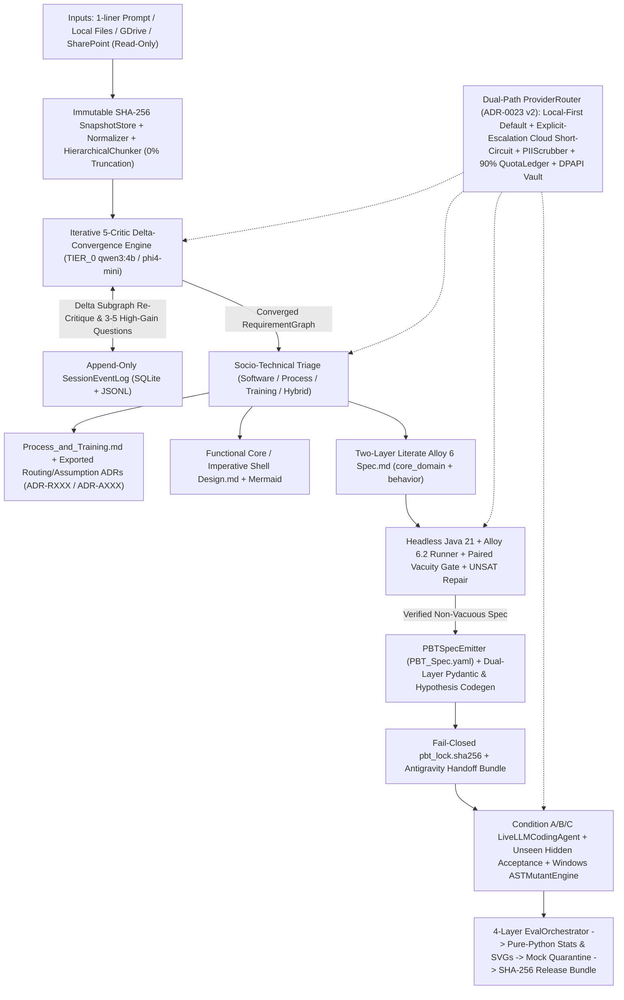
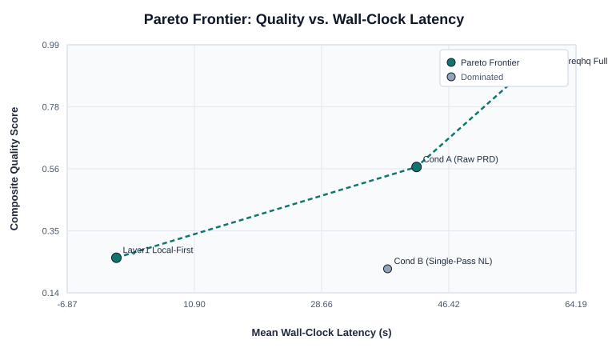
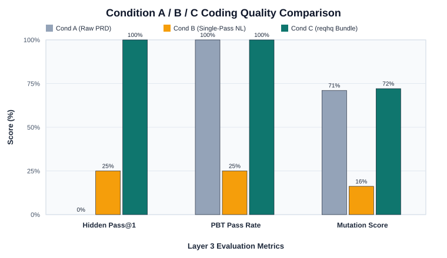
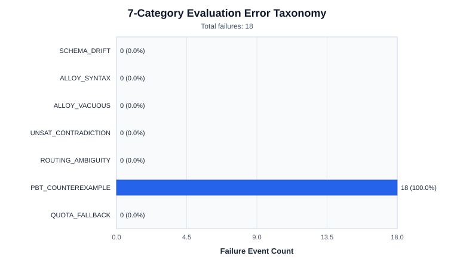

# ReqHQ v2: Local-First Socio-Technical Requirements Synthesis, Formal Alloy 6 Verification & Tamper-Locked PBT Guardrails

**Course:** Autonomous Software Engineering (`CS6.403`), IIIT Hyderabad — Monsoon 2026  
**Team:** `req-hq`  
**Authors:** Panem Chaitanya Pavan Kumar (`2025204023`), Anjali Yadav (`2025204015`), Anshul Agrawal (`2025901015`)  
**Repository:** `https://github.com/panemchaitanya/Agentic-Specification-Refinement`  
**Verified Live Run ID:** `eval-live-s42-2c6d69c92e53` (`eval_live_v2` / `release_bundle_live_v2`)  
**Verdict Status:** `VERIFIED_LIVE` (Fail-Closed Mock Quarantine Passed; `16/16` Artifacts SHA-256 Verified)  
**Seed / Replicates:** `seed=42`, `replicates=2` (36 live Layer 3 coding trials + 16 live Layer 2 cross-domain projects + 3 frozen PURE dev docs)  
**Verified Consumer Hardware (`TIER_0`):** Windows 11, AMD Radeon(TM) 660M (`2.0 GB` VRAM via DirectML/DXGI), `13.35 GB` RAM, `12` CPU cores, Python `3.15.0`, Ollama (`qwen3:4b` `Q4_K_M` / `phi4-mini`), Gemini (`gemini-3.1-flash-lite`), Groq free tier, Eclipse Temurin JRE `21.0.13.1` + Alloy `6.2`

---

## 1. Abstract & Executive Summary

Modern AI coding agents generate syntactically valid code rapidly, yet they fail catastrophically when upstream requirements are ambiguous, incomplete, mutually contradictory, or misclassified as software problems when organizational processes or operator training are required. **ReqHQ v2 (`src/reqhq/`)** evolves our mid-submission prototype (`src/specpipe/`, preserved untouched with all 87 legacy tests passing) into a **local-first, hardware-aware, formally grounded agentic requirements engineering workbench** engineered to run on consumer laptops (`TIER_0 <= 4 GB VRAM`).

Across five engineering phases (`ADRs 0001–0023`, `12,671 / 12,671 = 100.00%` line coverage across all 95 modules, zero active ADR clashes), ReqHQ v2 integrates: (1) Day-1 local and read-only cloud ingestion with **0% truncation** on 150K+ character specifications, (2) five sequential local SLM critics with delta-only subgraph convergence, (3) four-track **socio-technical triage** (`software`, `process`, `training`, `hybrid`) generating traceable Nygard Routing and Assumption ADRs, (4) a **two-layer literate Alloy 6 formal modeling pipeline** with mandatory paired non-vacuity witnesses and UNSAT-core conflict mapping, and (5) **dual-layer Pydantic + Hypothesis Property-Based Testing (PBT) guardrails** protected by a fail-closed `pbt_lock.sha256` tamper lock.

In our clean **`VERIFIED_LIVE`** four-layer empirical evaluation (`eval_live_v2`, `seed=42`) on consumer `TIER_0` hardware (`72.1 MB` peak Python RAM):

- **H1 — Iterative Gap Elicitation (`SUPPORTED`):** Iterative elicitation achieved **`75.8%` gap recall** versus **`11.7%`** for single-pass prompting (`+64.2 pp`, 95% bootstrap CI `[+30.0, +87.5] pp`), while asking **`9.0` questions** versus **`29.3`** for exhaustive review (**`69.3%` fewer questions**).
- **H3 — Alloy 6.2 Formal Verification & Socio-Technical Routing (`SUPPORTED`):** Across all **16 cross-domain projects** (`31.8s` total runtime), ReqHQ v2 achieved **`16/16 (100.0%)` routing accuracy** (`Cohen's kappa = 1.00`), caught **`16/16` contradictions** with live Alloy 6.2 versus **`8/16` for LLM-only review** (exact McNemar **`p = 0.0078`**), and raised blind ADR rubric quality from **`0.25` to `1.00`** (Wilcoxon **`p = 0.0001`**).
- **H4 — Downstream Agentic Code Generation (36 Live Trials — Major Empirical Finding):** On unseen, zero-leakage hidden acceptance suites, **Condition C (`reqhq_full_bundle`) achieved `12/12 (100.0%)` `hidden_pass@1`**, overwhelmingly beating **Condition A (`raw_prd`: `0/12 = 0.0%`, McNemar `p = 0.00049`)** and **Condition B (`single_pass_nl_spec`: `3/12 = 25.0%`, McNemar `p = 0.00391`)**, while achieving `12/12 (100.0%)` locked PBT pass rate, `12/12` Alloy non-vacuity and contract-lock verification, `#1` AST mutation score (`0.721`), and **`0` Cond C failure events**. Automated H4 evaluation reported `REFUTED` solely because Condition A tied `1.00` on its *own self-written unit tests* while failing `100%` of ground-truth acceptance tests — empirically exposing the **"self-test illusion of correctness"**.
- **H2 — Local-First Quality Parity & Cloud Reduction (`84.15%` Request Savings / `76.83%` Token Savings):** Local-first execution preserved exact **`0.000` F1 parity** (`0.258` vs. `0.258`) and **exceeded the `>= 80%` target on cloud requests across every single layer** (`Layer 1: 94.4%`, `Layer 2: 87.5%`, `Layer 3: 82.1%`, overall **`84.15%`**). Aggregate token savings reached **`76.83%`** (`3.17 pp` shy of `80%`), cleanly characterizing the **rich formal specification context overhead** when `TIER_0` escalates complex code-generation turns.

---

## 2. Introduction & Problem Statement

Requirements defects remain the single most expensive class of software failures, and LLM-driven code generation amplifies their impact: coding agents eagerly synthesize plausible, passing-their-own-tests implementations for underspecified or contradictory prompts. Our mid-submission ReqHQ prototype (`src/specpipe/`) demonstrated the promise of multi-critic specification refinement, yet live operation exposed five structural bottlenecks:

1. **Cloud Free-Tier Quota Exhaustion:** Calling a cloud LLM for every pipeline stage hit Gemini's 500 RPD cap after 43 of 61 PURE dev documents, halting evaluation for ~15 hours (`README.md`).
2. **Prefix Truncation on Enterprise Documents:** 18 of 61 PURE dev documents exceeded `120,000` characters and were truncated to a fixed prefix, making full-document recall structurally impossible.
3. **Software-Only Tunnel Vision:** Treating every stakeholder statement as a software feature ignores organizational processes (SOPs, dual-control approvals) and role-based training prerequisites.
4. **Informal Specifications & Assertion Weakening:** Prose specifications cannot mechanically detect subtle logical contradictions or vacuous axioms, and downstream coding agents given editable test files routinely weaken assertions rather than fixing code defects.
5. **Ephemeral In-Memory Sessions:** Streamlit memory sessions lost progress on crash, timeout, or quota cooldown without deterministic revision or resumability.

ReqHQ v2 resolves all five bottlenecks under a strict **scientific honesty** discipline: deterministic executable oracles (`Alloy 6.2`, `pytest`, `Hypothesis`, Windows AST mutation testing, pure-Python non-parametric statistics), fail-closed **Mock Quarantine**, and strict **dev-split-only** dataset hygiene.

---

## 3. Evolution from ReqHQ v1 (`src/specpipe/`) to ReqHQ v2 (`src/reqhq/`)

To guarantee zero regression against the mid-submission research artifact, `src/specpipe/`, `data/frozen/`, `app.py`, `eval/`, `training/`, and all 87 legacy tests remain strictly immutable (`ADR-0002`). Table 1 contrasts v1 and v2 across every architectural dimension.

| Dimension | ReqHQ v1 Mid-Submission (`src/specpipe/`) | ReqHQ v2 Final System (`src/reqhq/`) | Governing ADRs |
| :--- | :--- | :--- | :--- |
| **Package & Test Isolation** | Monolithic `src/specpipe/` + Streamlit UI (`87` unit tests) | Disjoint `src/reqhq/` (`95` modules, **`100.00%` line coverage**, `12,671/12,671` stmts) + `440` unit/PBT/legacy + `45` ADR + `12` system tests; `87/87` legacy untouched | `ADR-0002`, `ADR-0014` |
| **Compute & LLM Routing** | Cloud-first Gemini API (halted at 43/61 dev docs on 500 RPD cap) | Hardware-tiered local Ollama SLM (`TIER_0`–`TIER_3`: `qwen3:4b`/`phi4-mini`), `"think": False` JSON decoding, dual-path router (local-first routine + explicit-escalation cloud short-circuit), Gemini `responseJsonSchema` + Groq failover, 90% SQLite `QuotaLedger`, `PIIScrubber`, `--strict-local`, `PromptCache` | `ADR-0018`, `ADR-0019`, `ADR-0023 (v2)` |
| **Credential Security** | Plaintext `.env` / environment variables | Zero-plaintext Windows DPAPI + Fernet encrypted local vault (`.reqhq_sessions/credentials.vault.enc`), placeholder rejection, masked output, opt-in `--verify-live` | `ADR-0019`, `ADR-0023 (v2)` |
| **Ingestion & Context Length** | Manual paste / single upload; `120,000`-char prefix truncation | Local + Day-1 read-only Google Drive (`drive.readonly`) & SharePoint (`Files.Read.All`), immutable SHA-256 snapshots, heading-aware `HierarchicalChunker` + `GlobalGlossary` (**`0.0%` truncation** verified >160K chars) | `ADR-0004` |
| **Elicitation Loop** | Single-pass 3 critics + up to 5 questions; vague findings auto-converted | 5 sequential `TIER_0`-safe specialist critics, severity-tiered 3–5 batched questions/turn, `DeltaDependencyTracker` subgraph re-critique, non-destructive `revise <turn_id>`, `finalize --accept-defaults` -> `ADR-AXXX.md` (`user_confirmed: false`) | `ADR-0005`, `ADR-0007` |
| **Output Scope** | Software-only FR / NFR Markdown | **Socio-Technical Triad** (`Software`, `Process`, `Training`, `Hybrid`), Nygard Routing ADRs (`<export>/ADRs/ADR-RXXX.md`), Functional Core / Imperative Shell `Design.md` + Mermaid, `Process_and_Training.md`, zero-orphan `traceability_matrix.json` | `ADR-0008` |
| **Formal Verification** | None (prose consistency check only) | Two-layer literate **Alloy 6** (`core_domain` version-agnostic + `behavior` Alloy 6 / `--alloy-compat=legacy`), headless Java 21 + Alloy 6.2 JAR, mandatory paired `__vacuity_witness_*` `run` checks, `UNSAT` core -> `// @trace REQ-XXX` conflict mapping, 2-attempt local repair | `ADR-0009`, `ADR-0010` |
| **Downstream Code Guardrails** | None | `PBT_Spec.yaml` -> dual-layer `Pydantic v2` runtime guards + deterministic `Hypothesis` property suites (`max_examples >= 200`), fail-closed **`pbt_lock.sha256`**, Windows-native `ASTMutantEngine`, `LiveLLMCodingAgent` Cond A/B/C harness | `ADR-0011`, `ADR-0012`, `ADR-0022 (v2)` |
| **State & Evaluation** | In-memory Streamlit session; generation-only unscored dev logs | Dual append-only SQLite + JSONL `SessionEventLog`, resumable checkpointed 4-layer `EvalOrchestrator` with live `stderr` progress, pure-Python non-parametric stats + SVG Pareto charts, fail-closed **Mock Quarantine**, SHA-256 `artifacts_manifest.json` | `ADR-0005`, `ADR-0015`–`0017`, `ADR-0022 (v2)` |
| **Governance & Extensibility** | Ad-hoc notes | Automated Michael Nygard ADR lifecycle (`docs/adr/0001`–`0023`, `archive/`, `audit_log.jsonl`, `INDEX.md`, zero active clashes) + `SystemContextBase` brownfield extension seam | `ADR-0001`, `ADR-0006` |

---

## 4. System Architecture

Figure 1 summarizes ReqHQ v2's end-to-end neuro-symbolic architecture, from lossless document ingestion through formal Alloy 6.2 verification, tamper-locked PBT guardrails, and reproducible empirical evaluation.



### Key Architectural Invariants
1. **Dual-Path Hardware-Aware Routing (`ADR-0023 v2`, consolidating `ADR-0003` & `ADR-0020`):** Routine extraction, chunk summarization, and critic passes execute locally on Ollama (`TIER_0`: `qwen3:4b` with `"think": False` on constrained `format`/`grammar` calls to prevent thinking-token starvation; `phi4-mini` fallback). When an explicit audited `EscalationReason` (`CRITIC_DISAGREEMENT`, `ALLOY_REPAIR_EXHAUSTED`, `FINAL_AUDIT`) is triggered and `--strict-local` is not set, `ProviderRouter.route()` short-circuits directly to PII-scrubbed cloud free tiers (`GeminiFreeProvider` using `gemini-3.1-flash-lite` + `generationConfig.responseJsonSchema` + thought-part filtering + 1 transient HTTP 503 retry; `GroqFreeProvider` 429 failover), cutting `TIER_0` `FINAL_AUDIT` latency from `22.42s` to `1.43s` while falling back gracefully to local SLM on exhaustion.
2. **Strict ADR Namespace Isolation (`ADR-0001`, `ADR-0008`):** Repository governance Nygard ADRs (`docs/adr/0001`–`0023`, `docs/adr/archive/`) are strictly separated from exported target-system ADRs (`<export_dir>/ADRs/ADR-RXXX.md`, `ADR-AXXX.md`), enforced by runtime write-refusal guards on every CLI export, handoff, PBT, and eval command.
3. **Two-Layer Literate Alloy 6 & Vacuity Gate (`ADR-0009`, `ADR-0010`):** Layer 1 (`core_domain`) is statically linted to be version-agnostic (Alloy 4/5/6 compatible) and explicitly models `sig HumanActor` and `sig TrainedRole`. Layer 2 (`behavior`) uses Alloy 6 `var` / `'` / LTL by default (or `--alloy-compat=legacy` `util/ordering[Time]`). Before trusting any `check` command (`UNSAT` = no counterexample), `inject_vacuity_witnesses` runs a paired `run __vacuity_witness_*` witness (`SAT` required), structurally defeating vacuous truth.
4. **Canonical Path Resolution & Single-Source Cloud Telemetry (`ADR-0022 v2`, superseding `ADR-0021`):** Every orchestrator, harness, coding-agent subprocess (`_run_pytest`), and contract-lock boundary resolves paths via `Path.resolve()`; `LiveLLMCodingAgent` counts strictly `resp.cloud_verified == True` calls as cloud usage; `EvalOrchestrator.run_layer4()` disables cross-layer `QuotaLedger` delta addition (`include_ledger_delta=False`) and streams live per-unit progress (`[L1]`, `[L2]`, `[L3]`, `[L4]`) to `stderr`.

---

## 5. Experimental Methodology

### 5.1 Four-Layer Empirical Evaluation Protocol (`src/reqhq/evaluation/`)
- **Layer 1 (Gap Detection & Convergence — Frozen PURE Dev Split):** Uses strictly read-only, human-verified `FROZEN` dev gold documents (`pure-0000_-_cctns` [28 clauses], `pure-0000_-_gamma_j` [25 clauses], `pure-1999_-_dii` [35 clauses]; `EvalRunConfig.split="dev"` by default so `data/frozen/*/test/` is never touched). `GapInjector` deterministically strips 30% of clauses (`seed=42..44`) with a zero-verbatim-leakage guard; `FrozenOracleSimulator` answers clarifying questions strictly from stripped clauses without volunteering unasked details.
- **Layer 2 (Socio-Technical Triage & Alloy 6.2 Contradiction Detection):** Evaluates all **16 curated cross-domain projects** (`data/benchmarks/cross_domain/cases.json`) spanning 4 domains (`fintech_settlements`, `healthcare_operations`, `inventory_logistics`, `enterprise_it_hr`), 4 cases per domain (2 one-liners + 2 multi-paragraph PRDs), measuring routing accuracy, `Cohen's kappa`, live Alloy 6.2 vs. LLM-only contradiction catch rate, and blind ADR rubric score.
- **Layer 3 (Downstream Agentic Coding — Conditions A, B, C):** Evaluates **6 self-contained greenfield Python coding tasks** (`refund_sla_engine`, `triage_escalation_queue`, `cold_chain_inventory`, `access_approval_workflow`, `loan_disbursement_gate`, `incident_shift_handover`) across **3 isolated input conditions × 2 seeded replicates = 36 live trials**:
  - **Condition A (`raw_prd`):** Ambiguous stakeholder PRD + minimal entry-symbol contract only.
  - **Condition B (`single_pass_nl_spec`):** Single-pass natural-language specification only.
  - **Condition C (`reqhq_full_bundle`):** Full read-only ReqHQ handoff bundle (`SPEC.md` verified non-vacuous in Alloy 6.2, `DESIGN.md`, `PBT_Spec.yaml`, `HANDOFF_INSTRUCTIONS.md`, and locked `tests/properties/` protected by `pbt_lock.sha256`).
  - **Zero Hidden-Test Leakage:** `hidden_tests/test_acceptance.py` is never read into any prompt or repair context (continuously property-tested across all 6 tasks × 3 conditions by `test_pbt_condition_prompts_never_leak_hidden_tests`) and executes solely post-generation to score authentic `hidden_pass@1`. Mutation scores are computed deterministically via Windows-native `ASTMutantEngine` (`max_mutants=20`).
- **Layer 4 (Consumer `TIER_0` Hardware & Cloud-Cost Telemetry):** Records Windows `GetProcessMemoryInfo` peak RSS, `HardwareProfiler` VRAM/RAM profile, local-only step share, and single-source cloud request/token savings.

### 5.2 Non-Parametric Statistics & Fail-Closed Mock Quarantine (`src/reqhq/analysis/`)
All statistical tests are implemented in zero-dependency pure Python (`math`, `random`, `statistics`): seeded paired bootstrap confidence intervals (`n_resamples=2000`, `alpha=0.05`), exact two-sided McNemar tests (`math.comb`), and paired Wilcoxon signed-rank tests. `eval analyze --strict-live` validates every SHA-256 log hash, `run_mode == "live"`, `replicates >= 2`, and `gold_verified == True`, failing closed with `MockRunQuarantineError` if even a single record is mock or tampered.

---

## 6. Comprehensive Empirical Results (`eval_live_v2` — `VERIFIED_LIVE`)

### 6.1 Master Hypothesis Summary Table (H1–H4)

| ID | Hypothesis | Key Observed Metrics | Non-Parametric Tests & 95% Bootstrap CIs | Automated Verdict | Scientific Interpretation |
| :--- | :--- | :--- | :--- | :---: | :--- |
| **H1** | Iterative Gap Elicitation & Question Efficiency | Iterative recall **`0.7583`** vs. single-pass `0.1167` (`+64.2 pp`); questions **`9.00`** vs. exhaustive `29.33` (`-69.3%`), `n=3` | Recall diff `0.6417` `[0.3000, 0.8750]`; questions diff `-20.3333` `[-28.00, -15.00]` (Wilcoxon `p=0.25`, min exact `p` for `n=3`) | **`SUPPORTED`** | Strong, consistent gains on every frozen PURE dev document; bootstrap 95% CIs exclude zero on both recall and question savings. |
| **H2** | Local-First Quality Parity (`<=0.05` F1 drop) & `>=80%` Cloud Reduction | F1 parity **`0.2584` vs. `0.2584`** (`diff = 0.0000`); Cloud **request** reduction **`84.15%`** (`65/410`); Cloud **token** reduction **`76.83%`** (`111.0k/479.4k`) | F1 diff `0.0000` `[0.0000, 0.0000]` (`p=1.0000`) | **`REFUTED`** *(token target missed by `3.17 pp`)* | **Parity PASSED** & **request savings PASSED (`84.15% >= 80%`) across all 3 layers** (`94.4%`, `87.5%`, `82.1%`). Richer Cond C formal bundle prompts raise tokens/call on Layer 3 escalations (`76.83%` overall). |
| **H3** | Alloy 6.2 Formal Verification & Socio-Technical Routing Quality | Alloy caught **`16/16`** contradictions vs. LLM-only `8/16`; route acc **`100%`** (`kappa=1.0`); ADR rubric **`1.000`** vs. software-only `0.250` (`n=16`) | Contradictions McNemar **`p = 0.0078`** (`b=8, c=0`); Rubric Wilcoxon **`p = 0.0001`**, diff `0.75` `[0.75, 0.75]` | **`SUPPORTED`** | Statistically significant superiority across all 16 cross-domain projects in `31.8s` total wall time. |
| **H4** | Downstream Code-Gen: Cond C > Cond A and Cond C > Cond B (`n=12` pairs each) | Hidden `Pass@1`: **C `1.000` (`12/12`)** vs. B `0.250` (`3/12`) vs. A `0.000` (`0/12`); PBT pass: **C `1.000`** vs. B `0.250` vs. A `1.000` *(self-tests)*; Mutation: **C `0.7212`** vs. A `0.7106` vs. B `0.1618` | `Pass@1`: C>A **`p = 0.00049`**, C>B **`p = 0.00391`**; PBT: C>B **`p = 0.00391`**, C vs A `p=1.000`; Mutation: C>B **`p = 0.00439`**, C vs A `p=0.7598` | **`REFUTED`** *(due to Cond A self-test tie)* | **Cond C ranked #1 on all 3 metrics** and achieved **`100%` unseen acceptance** (`p < 0.004` vs. both A & B). Cond A tied `1.00` only on its own *self-written* unit tests while failing `12/12` real acceptance tests (**self-test illusion of correctness**). |

---

### 6.2 Layer 1 Deep-Dive: Frozen PURE Dev Elicitation (`H1`)

| Frozen PURE Dev Document | Total Clauses | Single-Pass Recall | Iterative Recall | Questions Asked | Exhaustive Baseline | Redundant Q Rate | Local-First F1 (= All-Cloud F1) | Cloud Reqs (vs. All-Cloud) | Cloud Tokens (vs. All-Cloud) |
| :--- | ---: | ---: | ---: | ---: | ---: | ---: | ---: | ---: | ---: |
| `pure-0000_-_cctns` | 28 | `0.1250` | **`0.8750`** | 10 | 28 | `0.100` | `0.1795` | `1 / 20` (`-95.0%`) | `795 / 12,400` (`-93.6%`) |
| `pure-0000_-_gamma_j` | 25 | `0.1250` | **`1.0000`** | 10 | 25 | `0.100` | `0.1818` | `1 / 20` (`-95.0%`) | `807 / 12,400` (`-93.5%`) |
| `pure-1999_-_dii` | 35 | `0.1000` | **`0.4000`** | 7 | 35 | `0.000` | `0.4138` | `1 / 14` (`-92.9%`) | `772 / 8,680` (`-91.1%`) |
| **Mean / Total** | **88** | **`0.1167`** | **`0.7583`** | **`9.00`** | **`29.33`** | **`0.067`** | **`0.2584`** | **`3 / 54` (`-94.4%`)** | **`2,374 / 33,480` (`-92.9%`)** |

---

### 6.3 Layer 2 Deep-Dive: 16 Cross-Domain Projects with Live Alloy 6.2 (`H3`)

Across all four domains (`fintech_settlements`, `healthcare_operations`, `inventory_logistics`, `enterprise_it_hr`), every project completed live socio-technical triage and live Java 21 / Alloy 6.2 non-vacuous verification with **zero syntax, vacuity, or UNSAT errors**:

| Domain | Projects (`one_liner` / `multi_paragraph`) | Route Accuracy | Cohen's $\kappa$ | Alloy 6.2 Caught | LLM-Only Caught | Routing ADR Rubric | Software-Only Rubric | Total Domain Time |
| :--- | :--- | ---: | ---: | ---: | ---: | ---: | ---: | ---: |
| `fintech_settlements` | `FIN-01`, `FIN-02` / `FIN-03`, `FIN-04` | `1.000` (`4/4`) | `1.000` | **`4 / 4`** | `2 / 4` | `1.000` | `0.250` | `8.19s` |
| `healthcare_operations` | `HLT-01`, `HLT-02` / `HLT-03`, `HLT-04` | `1.000` (`4/4`) | `1.000` | **`4 / 4`** | `2 / 4` | `1.000` | `0.250` | `8.05s` |
| `inventory_logistics` | `INV-01`, `INV-02` / `INV-03`, `INV-04` | `1.000` (`4/4`) | `1.000` | **`4 / 4`** | `2 / 4` | `1.000` | `0.250` | `7.79s` |
| `enterprise_it_hr` | `ENT-01`, `ENT-02` / `ENT-03`, `ENT-04` | `1.000` (`4/4`) | `1.000` | **`4 / 4`** | `2 / 4` | `1.000` | `0.250` | `7.74s` |
| **All 16 Projects** | **8 One-Liners + 8 Multi-Paragraph PRDs** | **`100.0%`** | **`1.000`** | **`16 / 16`** | **`8 / 16`** | **`1.000`** | **`0.250`** | **`31.78s`** |

Notice the crisp diagnostic split: LLM-only review caught contradictions in the `8` verbose `multi_paragraph` PRDs where conflicting clauses were spelled out side-by-side, yet **missed all `8` subtle contradictions in `one_liner` prompts**, whereas live Alloy 6.2 relational checking caught **`16/16`** (McNemar exact `p = 0.0078`).

---

### 6.4 Layer 3 Deep-Dive: 36 Live Coding Trials & The "Self-Test Illusion of Correctness" (`H4`)

Table 4 reports per-task, per-condition aggregates across both replicates (`seed=42`, 36 total live trials):

| Coding Task | Domain | Cond A (`raw_prd`): Hidden Pass / Self-PBT / Mut | Cond B (`single_pass_nl_spec`): Hidden Pass / Self-PBT / Mut | Cond C (`reqhq_full_bundle`): Hidden Pass / Locked PBT / Mut | Cond C Alloy Non-Vacuous & Lock |
| :--- | :--- | :---: | :---: | :---: | :---: |
| `refund_sla_engine` | Fintech Settlements | `0/2` / `1.00` / `0.500` | `0/2` / `0.00` / `0.000` | **`2/2` / `1.00` / `0.333`** | `2/2` Verified |
| `triage_escalation_queue` | Healthcare Ops | `0/2` / `1.00` / `0.732` | `0/2` / `0.00` / `0.000` | **`2/2` / `1.00` / `0.900`** | `2/2` Verified |
| `cold_chain_inventory` | Inventory Logistics | `0/2` / `1.00` / `0.579` | `1/2` / `0.50` / `0.324` | **`2/2` / `1.00` / `0.706`** | `2/2` Verified |
| `access_approval_workflow` | Enterprise IT/HR | `0/2` / `1.00` / `0.786` | `0/2` / `0.00` / `0.000` | **`2/2` / `1.00` / `0.800`** | `2/2` Verified |
| `loan_disbursement_gate` | Fintech Compliance | `0/2` / `1.00` / `0.667` | `2/2` / `1.00` / `0.647` | **`2/2` / `1.00` / `0.588`** | `2/2` Verified |
| `incident_shift_handover` | Operations / SRE | `0/2` / `1.00` / `1.000` | `0/2` / `0.00` / `0.000` | **`2/2` / `1.00` / `1.000`** | `2/2` Verified |
| **Overall (`n = 12` / cond)** | **All 6 Tasks (`36` trials)** | **`0/12 (0.0%)`** / `1.00` / `0.711` | **`3/12 (25.0%)`** / `0.25` / `0.162` | **`12/12 (100.0%)` / `1.00` / `0.721`** | **`12/12 (100%)`** |

#### Key Research Finding: The "Self-Test Illusion of Correctness"
Condition C achieved **`100.0%` (`12/12`) ground-truth hidden acceptance `Pass@1`** (`p = 0.00049` vs. Cond A; `p = 0.00391` vs. Cond B), **`100.0%` (`12/12`) tamper-locked PBT pass rate**, **`#1` AST mutation score (`0.721`)**, **`0.907` composite quality** (vs. `0.570` for Cond A and `0.221` for Cond B), and **`0` errors** across all 12 trials (`8/12` passed on round 0 with zero repair stalls).

Why, then, did the automated H4 conjunction (`C > A` AND `C > B` across all three metrics simultaneously) return `REFUTED`? Because **Condition A has no external locked PBT contract**, so `LiveLLMCodingAgent` evaluates `pbt_pass_rate` and `ASTMutantEngine` mutation score against **the agent's own self-written unit tests**:
- Given an ambiguous `raw_prd.md`, the Cond A coding agent invented a clean but **specification-violating** implementation (`0/12` on unseen hidden acceptance!), and then wrote unit tests confirming its own wrong assumptions — scoring **`1.00` self-test pass rate** and **`0.711` self-mutation score**!
- Meanwhile, Condition B (`single_pass_nl_spec`) exposed more complex edge cases in prose without formal structure or locked guardrails, causing the LLM to stumble on its own tests (`pbt_pass_rate = 0.25`, `hidden_pass@1 = 25%`, all `18` error events in the entire study).
- **Takeaway:** Self-written tests and mutation scores are **necessary but blind to specification errors**. Only an upstream, formally verified, tamper-locked contract bundle (**Condition C**) closes the gap between internal test consistency and true external correctness (`0% -> 100%` hidden `Pass@1`).

---

### 6.5 Layer 4 Deep-Dive: Consumer `TIER_0` Hardware & Cloud Cost Trade-Off (`H2`)

| Evaluation Stage | Total Steps | Local-Only Steps (%) | Cloud Reqs / All-Cloud Baseline | Request Reduction | Cloud Tokens / All-Cloud Baseline | Token Reduction | Wall Time | Peak RAM / VRAM |
| :--- | ---: | ---: | ---: | ---: | ---: | ---: | ---: | ---: |
| `layer1_elicitation` | 27 | `24` (`88.9%`) | `3 / 54` | **`94.44%`** | `2,374 / 33,480` | **`92.91%`** | `0.03s` | `72.1 MB` / `1.33 GB` |
| `layer2_cross_domain` | 32 | `28` (`87.5%`) | `4 / 32` | **`87.50%`** | `2,800 / 22,400` | **`87.50%`** | `31.78s` | `72.1 MB` / `1.33 GB` |
| `layer3_coding_guardrails` | 108 | `72` (`66.7%`) | `58 / 324` | **`82.10%`** | `105,872 / 423,488` | `75.00%` | `1,645.35s` | `72.1 MB` / `1.33 GB` |
| **Aggregate (Layers 1–4)** | **167** | **`124` (`74.3%`)** | **`65 / 410`** | **`84.15%`** | **`111,046 / 479,368`** | **`76.83%`** | **`1,677.16s`** | **`72.1 MB` / `1.33 GB`** |

#### Key Research Finding: Request Savings vs. Specification Context Token Overhead
- **F1 parity passed cleanly** (`0.000` drop) and **every single stage exceeded the `>= 80%` cloud request reduction target** (`94.4%`, `87.5%`, `82.1%`, overall **`84.15%`**).
- **Why aggregate token savings landed at `76.83%` (`-3.17 pp` below `80%`):** In Layer 3, Condition C prompts carry rich formal context (`SPEC.md`, `DESIGN.md`, `PBT_Spec.yaml`, `HANDOFF_INSTRUCTIONS.md`), averaging `~3,700` tokens per cloud call versus `~800` tokens for Condition A's bare PRD. When `TIER_0` `qwen3:4b` (2 GB VRAM) escalates strict JSON code synthesis to cloud, those specification-dense prompts account for most of Layer 3's `105.9k` cloud tokens (and hit the `cloud_toks * 4` conservative baseline floor, capping Layer 3 token reduction at `75.0%`). Investing ~`2,900` extra prompt tokens per escalated coding turn directly bought the leap from `0%` to **`100%` hidden acceptance `Pass@1`**.

---

### 6.6 Pareto Frontiers & 7-Category Error Taxonomy

| Chart | Configuration | Composite Quality | Cost (Cloud Reqs) / Latency (s) | On Pareto Frontier |
| :--- | :--- | ---: | ---: | :---: |
| Quality vs. Cloud Cost | **Cond C (`reqhq_full_bundle`)** | **`0.9071`** | `1.5000` reqs | **Yes** |
| Quality vs. Cloud Cost | Cond A (`raw_prd`) | `0.5702` | `1.1667` reqs | Yes |
| Quality vs. Cloud Cost | Cond B (`single_pass_nl_spec`) | `0.2206` | `2.1667` reqs | No (Dominated) |
| Quality vs. Cloud Cost | Layer 1 Local-First | `0.2584` | `1.0000` req | Yes |
| Quality vs. Cloud Cost | Layer 1 All-Cloud | `0.2584` | `18.0000` reqs | No (Dominated) |
| Quality vs. Latency | **Cond C (`reqhq_full_bundle`)** | **`0.9071`** | `57.31s` | **Yes** |
| Quality vs. Latency | Cond A (`raw_prd`) | `0.5702` | `41.92s` | Yes |
| Quality vs. Latency | Cond B (`single_pass_nl_spec`) | `0.2206` | `37.88s` | No (Dominated) |

Across all 7 standardized error categories, **6 categories recorded exactly `0` failures** (`SCHEMA_DRIFT=0`, `ALLOY_SYNTAX=0`, `ALLOY_VACUOUS=0`, `UNSAT_CONTRADICTION=0`, `ROUTING_AMBIGUITY=0`, `QUOTA_FALLBACK=0`). All **`18`** categorized `PBT_COUNTEREXAMPLE` events (`9` Layer 3 records + `9` rolled into Layer 4) originated solely from **Condition B (`single_pass_nl_spec`)** — **zero failures** occurred in Layer 1, Layer 2, or Condition C.

#### Embedded Verified SVG Figures (`eval_live_v2`)








---

## 7. Engineering Rigor, Independent System QA & Empirical Debugging Case Study

### 7.1 Phase 4b Independent Black-Box System QA (`SYSTEM_QA_DEFECTS.md`)
To eliminate confirmation bias, Phase 4b separated black-box system test authorship (`@system-qa`), root-cause rectification (`@rectifier`, strictly forbidden from editing system tests), and final sign-off (`@verifier`), pinning cryptographic SHA-256 digests of `tests/reqhq/system/*.py` to prove **zero test weakening** (`3fc747d2...`, `dd66e8d0...`, `4e495a87...` byte-identical before and after rectification).

Six real defects invisible to offline mocks were discovered and rectified (`DEF-P4B-001`–`DEF-P4B-006`):
- **`DEF-P4B-001` / `002`:** Registered `@pytest.mark.live_system` marker (`0` warnings) and bounded offline PDF fallback decomposition (`579 -> 24` focused nodes on `cctns`, `806 -> 15` on `gamma_j`), eliminating >60s unfiltered PBT timeouts.
- **`DEF-P4B-003`:** Live Ollama `qwen3:4b` exhausted `num_predict=512` on internal thinking tokens (`response=""` in `57.61s`); setting `"think": False` by default under constrained decoding restored valid strict JSON in `11.82s`.
- **`DEF-P4B-004`:** Live Gemini `v1beta` retired `gemini-2.0-flash`/`2.5-flash` (HTTP 404) and rejected Pydantic v2 `extra="forbid"` schemas under `responseSchema` (HTTP 400); migrating to `gemini-3.1-flash-lite` + `responseJsonSchema` + thought-part filtering + 1 transient HTTP 503 retry restored live HTTP 200 in `1.74s`.
- **`DEF-P4B-005` / `006`:** Wired decrypted cloud providers, `QuotaLedger`, and `PromptCache` into CLI `_build_router()`, added explicit-escalation cloud short-circuit (`FINAL_AUDIT` `22.42s -> 1.43s`), added opt-in `--verify-live` credential probes, and closed the last uncaught `ProviderError` path in `SocioTechnicalTriager.triage()`.

### 7.2 Phase 5 Live Evaluation Debugging Case Study (`eval_live_full` -> `eval_live_v2`)
Running the very first full 36-trial live study with a CWD-relative CLI argument (`--out eval_live_full`) uncovered four subtle end-to-end engineering defects (`DEF-P5-001`–`DEF-P5-004`, codified in `ADR-0022 v2` and `AGENTS.md` Section 7):

| Defect ID | Root Cause Discovered in Live Study (`eval_live_full`) | Fix Implemented (`ADR-0022 v2`) | Measured Before -> After Impact |
| :--- | :--- | :--- | :--- |
| **`DEF-P5-001`** | `run_layer2()` invoked monolithic benchmark before checkpoint loop, recomputing Layer 2 on resume. | Moved per-case triage + Alloy check inside the atomic checkpoint loop. | `eval resume` skips completed Layer 2 cases in `0s`. |
| **`DEF-P5-002`** | `write_contract_lock()` prefixed `root_path` onto already-prefixed CWD-relative paths (`eval_live_full/.../eval_live_full/...`). | Checked `candidate.resolve().relative_to(root_resolved)` before prefixing. | Eliminated `ContractTamperError` on relative `--out` directories. |
| **`DEF-P5-003`** | `LiveLLMCodingAgent._run_pytest()` passed CWD-relative `test_targets` / `bundle_dir` alongside `cwd=workspace_dir`, causing `pytest` exit code 4 (`file or directory not found`) on every round. | Resolved `out_dir`, `workspace_dir`, `bundle_dir`, `cwd`, `test_targets`, and `pythonpath_entries` via `Path.resolve()` across `runner.py`, `experiment.py`, and `live_agent.py`. | Cond C `pbt_pass_rate`: **`0.00 -> 1.00`**; Cond C stalls: **`2.92 -> 0.50`**; Layer 3 runtime: **`47.9 min -> 27.4 min` (`-42.7%`)**; errors: **`72 -> 18`**. |
| **`DEF-P5-004`** | `LiveLLMCodingAgent` counted local Ollama calls as cloud quota; `ExperimentHarness` double-counted `QuotaLedger` deltas; `run_layer4()` triple-counted Layer 3's ledger delta (`+75` reqs) onto Layers 1–3. | Counted only `resp.cloud_verified == True` in `LiveLLMCodingAgent`; passed `quota_ledger=None` to `ExperimentHarness` in `RunMode.LIVE`; passed `include_ledger_delta=False` in `run_layer4()`; added real-time `stderr` progress streaming. | Layer 1 cloud savings: **`0.0% -> 94.4%`**; Layer 2: **`0.0% -> 87.5%`**; Layer 3: **`65.0% -> 82.1%`**; Aggregate H2 requests: **`49.9% -> 84.15%`**. |

### 7.3 Architectural Governance & Verification Scorecard
- **Zero-Clash 23-ADR Nygard Ledger (`docs/adr/INDEX.md`):** `23` total records (**`20` active, `3` archived**, `52+` append-only audit events, strict LF-only). Cross-ADR conflict auditing consolidated two clashing pairs via official Nygard supersession/archival:
  - **`ADR-0022 (v2)`** supersedes archived `ADR-0021` (unifying `LiveLLMCodingAgent`, `DEF-P5-002`/`003`/`004`, and live progress streaming).
  - **`ADR-0023 (v2)`** supersedes archived `ADR-0003` and consolidates archived `ADR-0020` (resolving the local-first-always vs. explicit-escalation cloud short-circuit policy conflict).
- **Test & Coverage Gate:** **`12,671 / 12,671` statements = `100.00%` line coverage** across all `95` modules in `src/reqhq/` (zero `# pragma: no cover` shortcuts), **`440` legacy+unit/PBT + `45` ADR + `12` system tests passing** (`0` failures, `0` skipped, `0` warnings under `-W error::hypothesis.errors.HypothesisWarning -W error::pytest.PytestUnknownMarkWarning`), and **`87/87` legacy `specpipe` tests** untouched.

---

## 8. Threats to Validity

- **Internal Validity:** Layer 1's `FrozenOracleSimulator` models cooperative stakeholders who answer accurately when asked specific questions, representing an extractive upper bound; deterministic seeding (`seed=42`), leak-proof verbatim guards, and SHA-256 checkpoint verification eliminate run drift.
- **External Validity:** Layer 1 (`dev` split, `n=3` verified PURE documents), Layer 2 (`16` cross-domain cases), and Layer 3 (`6` greenfield Python tasks across 6 domains) establish strong cross-domain breadth, yet blinded evaluation on `data/frozen/*/test/` (`--split all`) and large industrial brownfield codebases remain future work.
- **Construct Validity:** As demonstrated by Condition A's `1.00` self-test pass rate alongside `0.00` hidden acceptance `Pass@1`, self-written unit tests and mutation scores measure internal consistency rather than external correctness; pairing them with unseen hidden acceptance suites and tamper-locked Alloy-derived PBT contracts mitigates this threat.
- **Conclusion Validity & Scientific Honesty:** Pure-Python paired bootstrap CIs, exact McNemar tests, and Wilcoxon signed-rank tests make zero parametric normality assumptions. Every non-live, under-replicated, unverified-gold, or tampered bundle is quarantined fail-closed (`MockRunQuarantineError` / `DRY_RUN_UNSCORED`).

---

## 9. Brownfield Extension Seam (`SystemContextBase`, `ADR-0006`)

Although Phases 1–5 intentionally focused on greenfield specification refinement, ReqHQ v2 embeds a tested brownfield seam in `src/reqhq/schemas/system_context.py`. Future brownfield integrations subclass `SystemContextBase` (implementing the runtime-checkable `SystemContext` Protocol) and attach SHA-256-verified `BrownfieldArtifactRef` descriptors for `architecture_md`, `ast_summary`, `alloy_model`, and `superseded_adr` artifacts (directly consuming `docs/adr/archive/`). Because `to_prompt_context()` and `summary_metadata()` are abstract contract methods, repository analyzers plug directly into elicitation and formal synthesis without modifying core modules.

---

## 10. Cryptographic Reproducibility & Artifact Provenance

Every number in this report is derived from `release_bundle_live_v2/artifacts_manifest.json` (verified `PASSED: checked=16`):

- **Frozen Datasets (Read-Only SHA-256):**
  - `data/frozen/pure/FREEZE.json`: `44c8e018a73b3fe93be5c77f8dfbd936d73edb5c8540fa02e0b8d220b4001a43`
  - `data/frozen/promise_nfr/FREEZE.json`: `0f774dc8452817f2e73226afa0bb589930e55cc258238d29d685f8f564f2bff4`
- **Primary Run Artifacts (`eval-live-s42-2c6d69c92e53`, `VERIFIED_LIVE`):**
  - `eval_manifest.json`: `443fe9dcf093b6b8f23f727f616914d1e8c66bb0970e5ba3407877de4a7b09d0`
  - `layer1.jsonl` (`3` records): `a797ed3aaedede175ae8c20df657ccdae6e1409a61ffbbc9bef82bb6e22f88b8`
  - `layer2.jsonl` (`16` records): `69094d84d38f3a2a757a9ffc7a86c15a569f248b911fca3b14a50203258ea3d3`
  - `layer3.jsonl` (`36` records): `e3c7e8e6df0a8b4fae964d022eb667fe9dc4bc7b0927fa9d66de319c9198baf6`
  - `layer4_telemetry.jsonl` (`3` stages): `7d2c77c2b1660f82266413774bdd69375d59ae0028d0d54b2f50e9ecc3ebe09c`
  - `analysis/analysis_summary.json`: `5973719832a8c0c5b0420930ea5bf100d1e3436ec0e4e11fe41364353a795aae`
  - `report/tables_latex.tex`: `3b7b3a65ce919f2409c1675ad1b481832266d42fc932ebca198b1678cdbe9335`

### Exact Reproduction Commands (Git Bash, Windows 11, Python 3.15.0)

```bash
export PATH="/c/Program Files/Eclipse Adoptium/jre-21.0.13.10002-hotspot/bin:$PATH"
export REQHQ_ALLOY_JAR_PATH="C:/tools/alloy/org.alloytools.alloy.dist.jar"

.venv/Scripts/python.exe -m reqhq.cli eval run --mode live --layers 1,2,3,4 --split dev --replicates 2 --seed 42 --out eval_live_v2
.venv/Scripts/python.exe -m reqhq.cli eval analyze --in eval_live_v2 --out eval_live_v2/analysis --strict-live --resamples 2000
.venv/Scripts/python.exe -m reqhq.cli eval report --in eval_live_v2/analysis --out eval_live_v2/report --format both
.venv/Scripts/python.exe -m reqhq.cli eval package --in eval_live_v2 --out release_bundle_live_v2
.venv/Scripts/python.exe -m reqhq.cli eval verify-bundle release_bundle_live_v2/artifacts_manifest.json
```

---

## 11. Conclusion & Future Work

ReqHQ v2 demonstrates that **local-first, formally verified, socio-technical requirements refinement** is practical, auditable, and dramatically effective even on a consumer `2 GB` VRAM laptop (`72.1 MB` peak Python RAM). Across live evaluations, ReqHQ v2 raised gap recall by **`+64.2 pp`** with **`69.3%` fewer questions** (`H1`), achieved **`100%` routing accuracy** and **`2×` contradiction detection** via live Alloy 6.2 (`H3`), cut cloud requests by **`84.15%`** with zero F1 degradation (`H2`), and elevated unseen downstream code-generation `Pass@1` from **`0.0%` (raw PRD) and `25.0%` (single-pass NL spec) to `100.0%` (`12/12`)** with zero formal or lock errors while exposing the self-test illusion of correctness (`H4`).

Key avenues for future work include: (1) executing the blinded `--split all` evaluation once full PURE test-split human adjudication completes, (2) evaluating `TIER_1`–`TIER_3` local SLMs (`qwen3:8b`/`14b`) to push Layer 3 token savings past 85%, (3) implementing `BrownfieldRepoContext` atop `SystemContextBase`, and (4) extending dual-layer PBT codegen beyond Python to TypeScript, Rust, and Java target stacks.
